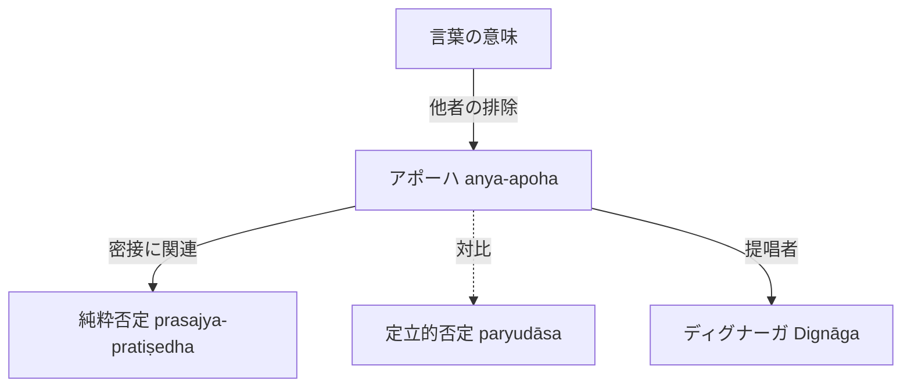

# アポーハ (anya-apoha / 他者の排除)

ディグナーガ（Dignāga）によって提唱された仏教徒における言葉の意味論。

## 一、 定義と根本命題
- 仏教徒にとって言葉の意味とは**他者の排除（アポーハ anya-apoha）**に他ならない（`序論.tex`）。
- 意味のネットワークにおける他項目との差異に言葉の意味を認める考え方である。
  - 例：「牛」という言葉が意味するところは、他のもの（ウサギや犬など）からの排除に他ならない。

## 二、 二種の否定との関係
インド思想における二種の否定：
1. **定立的否定（paryudāsa）**：あるものを否定した場合に、それとは別のものの肯定を含意する否定（例：「彼はバラモンではない」＝クシャトリヤ等を定立する）。
2. **純粋否定（prasajya-pratiṣedha）**：あるものを否定した場合に、別のものを決して定立することのない、単なる非存在・欠如だけを示す否定（例：「ここに壺はない」）。

- **論文における判定**：ディグナーガのアポーハ論は、**[[ja/純粋否定 (prasajya-pratiṣedha)|純粋否定]]**と密接な関係がある。

## 三、 概念連関図

