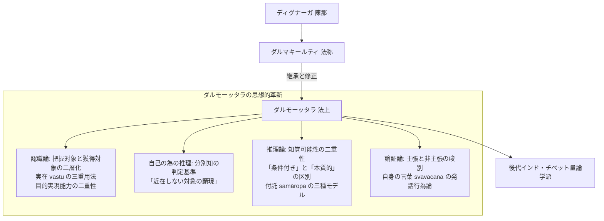

# ダルモーッタラ (法上 Dharmottara, ca. 740--800)

8世紀後半、カシミール出身と推測されるインド仏教論理学派・認識論の代表的学匠。ダルマキールティ（法称）の単なる注釈者にとどまらず、ダルマキールティの諸定義の論理的曖昧さを解消し、認識論・論理学の全領域において独創的な体系を築いた「独立した哲学者」。

## 一、 哲学者としてのダルモーッタラ：注釈を超えた思想的独創性

博士論文『結論』が総括するように、ダルモーッタラはダルマキールティの思想を着実に継承しつつ、その内実を保持しながら独自の理論修正を行い、後代インド（ジュニャーナシュリーミトラ、ラトナキールティ、モークシャカーラグプタ）およびチベット仏教論理学派の発展を決定づけた。

---

## 二、 主要な思想的達成（博士論文の分析による）

1. **認識論・対象論の再編**：
   - **[[ja/把握対象と獲得対象 (grāhya-prāpaṇīya)|把握対象と獲得対象（grāhya-prāpaṇīya）]]**：一刹那の把握対象と、刹那の相続上にある実在の獲得対象を分断・統一。ディグナーガ説とダルマキールティ説の対立を解消。
   - **[[ja/真に存在する実在 (vastu)|実在（vastu）]]の三重用法**：広義（認識対象一般）、狭義（目的実現能力を持つ独自相・勝義有）、因果連鎖の原因・結果。
   - **[[ja/目的実現と目的実現能力 (arthakriyāとarthakriyāsāmarthya)|目的実現能力（arthakriyāsāmarthya）]]の二重構造**：認識を生ぜしめる因果的能力（jñānajanakatva）と実践的用益の区別。

2. **分別知（vikalpa）の客観的判定基準**：
   - **[[ja/分別知の判定基準（近在しない対象の顕現）|近在しない対象の顕現（asannihitārtha-pratibhāsa）]]**：言語協約を持たない赤ん坊の認識（bālakalpanā）を有分別、ヨーガ行者の直観（yogijñāna）を無分別と判定する普遍的基準を確立。

3. **非認識因（anupalabdhi）の論理的精密化**：
   - **[[ja/知覚可能性の二重性（条件付きと本質的）|知覚可能性の二重性]]**：条件付き知覚可能性（全条件完備）と本質的知覚可能性（凡夫の観察可能性）の区別。
   - **[[ja/非認識因における付託の構造（三種のモデル）|付託（samāropa）の三種モデル]]**：通常の知覚可能対象、相互排除対立（屍鬼の非存在）、他の10種の非認識因（過去時の想起確認）における付託の構造解明。

4. **論証論・他者の為の推理（parārthānumāna）**：
   - **[[ja/主張の定義と非主張（pakṣaとapakṣa）|主張と五種の非主張の峻別]]**：疑似主張（即時排除）と他の四種の非主張（論証式全体の精査後に確定、uktamātra等）の判定時序と要件の相違を確定。
   - **[[ja/四種の疑似主張（pakṣābhāsa）|自身の言葉（svavacana）の独自解釈]]**：先行研究の自己矛盾説を退け、発話行為が伴う真実性承認（sadarthatva）に基づく前言矛盾として定式化。

---

## 三、 主要著作
- 『正理一滴論注』（*Nyāyabinduṭīkā*, NBṬ）
- 『量決択注』（*Pramāṇaviniścayaṭīkā*, PVinṬ）
- 『正理一滴論略注』（*Nyāyabindupiṇḍārtha*）
- 『刹那滅論証』（*Kṣaṇabhaṅgasiddhi*）
- 『他相続論証注』（*Saṃtānāntarasiddhiṭīkā*）
- 『アポーハ論』（*Apohaprakaraṇa*）

## 典拠
- 博士論文『序論』§0.7「ダルモーッタラ研究史」
- 博士論文『結論』

## 関連概念
- [[ja/正理一滴論 (Nyāyabindu)|正理一滴論 (Nyāyabindu)]]
- [[ja/正しい認識手段 (pramāṇa)|正しい認識手段 (pramāṇa)]]
- [[ja/把握対象と獲得対象 (grāhya-prāpaṇīya)|把握対象と獲得対象 (grāhya-prāpaṇīya)]]
- [[ja/分別知の判定基準（近在しない対象の顕現）|分別知の判定基準（近在しない対象の顕現）]]
- [[ja/知覚可能性の二重性（条件付きと本質的）|知覚可能性の二重性（条件付きと本質的）]]
- [[ja/非認識因における付託の構造（三種のモデル）|非認識因における付託の構造（三種のモデル）]]
- [[ja/主張の定義と非主張（pakṣaとapakṣa）|主張の定義と非主張（pakṣaとapakṣa）]]
- [[ja/四種の疑似主張（pakṣābhāsa）|四種の疑似主張（pakṣābhāsa）]]
