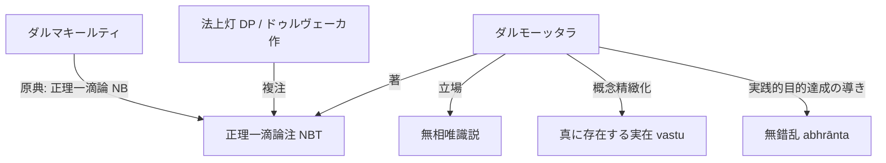

# ダルモーッタラ (法上 Dharmottara, ca. 740--800)

カシミール出身と推測されるインド仏教論理学派・認識論の学匠。

## 一、 思想的立場と伝承
- **師承**：シュバグプタ（Śubhagupta）およびアルチャタ（Arcaṭa / 達摩迦羅達多 Dharmākaradatta）の弟子。
- **認識論の立場**：**無相唯識説**（外界の実在を否定し、知覚知における所取・能取の二取の区分を世俗の迷乱とする立場）。後代のラトナーカラシャーンティ（Ratnākaraśānti）に影響を与えた。

## 二、 ダルマキールティ説の再解釈と独自性
1. **知覚論（[[ja/現量 (pratyakṣa)|知覚]]）**：
   - 「無錯乱」（abhrānta）を単なる感官の正常性にとどまらず、「認識が対象の真実の姿に合致し、実践的な目的の達成を導くこと」として捉え直す。
2. **存在論**：
   - 「真に存在する実在」（[[ja/真に存在する実在 (vastu)|vastu]]）の概念を精緻化し、[[ja/自相 (svalakṣaṇa)|独自相（自相）]]と客観的実在性との関係を展開。

## 三、 主要文献
- **主著**：『正理一滴論注』（*Nyāyabinduṭīkā*, NBT）
  - サンスクリット全章節が現存する第一級資料。
- **新出文献**：『量決択注』（*Pramāṇaviniścayaṭīkā*, PVinṬ）第3章（2020年サンスクリット刊本）。
- **注釈伝承**：
  - ドゥルヴェーカ・ミシュラ（Durveka Miśra, 11世紀）作『法上灯』（*Dharmottarapradīpa*, DP）がNBTの複注として現存。
  - チベット訳のみ現存するヴィニータデーヴァ（Vinītadeva）作『正理一滴論注』の記述を批判対象とする。

## 四、 概念連関図

