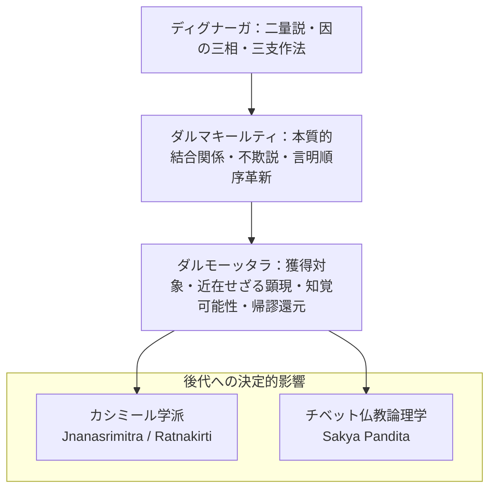

# ダルモーッタラ思想の結論と研究成果

本研究（博士論文『結論』）によって明らかにされた、ダルモーッタラ（法上 Dharmottara, ca. 740--800）の認識論・論理学体系の思想史的位置づけと主要な成果の総括。

---

## 一、 四大研究成果の総括

ダルモーッタラは単なるダルマキールティの忠実な注釈家にとどまらず、ダルマキールティの理論を発展的に継承し、より緻密で整合的な理論体系を構築した。

### 1. 認識手段論：実践的目的実現による知覚と推理の統合
- [[ja/正しい認識手段 (pramāṇa)|正しい認識手段]]を**「人を欺かないもの（avisaṃvādaka）」**と定義し、その本質を**行動対象（vastu）を示すこと**に置いた。
- [[ja/現量 (pratyakṣa)|知覚]]は直接に対象を示し、[[ja/比量 (anumāna)|推理]]は証因を介して対象を示すが、両者とも最終的に実在する対象の獲得を可能にする点で一致する。
- この解釈により、知覚と推理という一見対立する認識手段が、**実践的な目的実現（[[ja/目的実現と目的実現能力 (arthakriyāとarthakriyāsāmarthya)|arthakriyā]]）という共通の目標に向かって統合される理論的基盤**が確立された。

### 2. 分別論：「近在しない対象の顕現」による判定基準の深化
- [[ja/分別知の判定基準 (kalpanāとaniyatapratibhāsa)|分別知の判定基準]]として**「近在しない対象の顕現（aniyata-pratibhāsa）」**を提示し、従来の「言語的表現との結合（abhilāpasaṃsarga）」という基準を深化させた。
- これにより、言語を習得していない幼児などの認識においても、分別知の存在を論理的に説明することが可能となった。
- 感官知覚の直後に生起する[[ja/知覚判断 (adhyavasāya)|知覚判断]]を分別知として明確に位置づけ、無分別な知覚と分別的な判断の**連続性と断絶性**を精密に分析した。

### 3. 推理論・証因論：知覚可能性と言明順序の必然性
- [[ja/因の三相 (trairūpya)|証因の三相説]]を厳密に解釈し、特に[[ja/非認識因と付託の構造 (anupalabdhiとsamāropa)|非認識因（不可得因）]]が単なる認識の欠如ではなく、認識条件が満たされているにもかかわらず認識されないという**[[ja/知覚可能性の二重性 (upalabdhilakṣaṇaprāptatva)|「知覚可能性」]]に基づく積極的な判断**であることを論証した。
- [[ja/他者のための推理と論証式 (parārthānumānaとsādhana)|他者のための推理]]における論証式の構造を分析し、**[[ja/論証式における言明順序（遍充関係と主題所属性）|遍充関係を先に述べる言明順序の必然性]]**を明らかにした。

### 4. 主張論・過失論：立論者の意図と妥当性条件
- [[ja/主張の定義と非主張（pakṣaとapakṣa）|主張の定義]]において、ディグナーガの定義を詳細に注釈し、主張が**立論者の意図に基づくものであること、そして証因によって証明されるべき事柄そのものであること**を論証した。
- [[ja/四種の疑似主張 (pakṣābhāsa)|四種の疑似主張]]の分析を通じて、論争における主張の妥当性条件を厳密に規定した。

---

## 二、 思想史的意義：結節点としてのダルモーッタラ

- **後代学匠への継承**：
  ジュニャーナシュリーミトラ（Jñānaśrīmitra）、ラトナキールティ（Ratnakīrti）、モークシャーカラグプタ（Mokṣākaragupta）らは、ダルモーッタラが提起した「把握対象と獲得対象の区分」や「知覚可能性の論理」を受け継ぎ、発展させた。
- **チベット仏教への影響**：
  サキャ・パンディタ（Sa skya Paṇḍita）をはじめとするチベットの学僧たちによる量論注釈において、ダルモーッタラの解釈は標準的な参照枠組みとして機能しつづけた。

---

## 三、 今後の研究課題

1. **ダルモーッタラの他の著作の研究**：
   『刹那滅論証』（*Kṣaṇabhaṅgasiddhi*）、『他相続の論証』（*Santānāntarasiddhi*）、『量決択注』（*Pramāṇaviniścayaṭīkā*）との思想的連関の解明。
2. **他の注釈者（プラジュニャーカラグプタ等）との思想的対比**：
   カシミール仏教論理学の多様性と展開の解明。
3. **チベット仏教における受容と変容の追究**：
   チベット仏教論理学の形成過程におけるダルモーッタラ解釈の真の位置づけの確立。

---

## 典拠
- 博士論文『結論』§「結論」・§「今後の課題」
- ダルモーッタラ『正理一滴論注』（*Nyāyabinduṭīkā*）

## 関連概念
- [[ja/ダルモーッタラ認識論・論理学の全体構造 (The Architecture of Dharmottara's Epistemology and Logic)|ダルモーッタラ認識論・論理学の全体構造]]
- [[ja/ダルモーッタラ (Dharmottara)|ダルモーッタラ (Dharmottara)]]
- [[ja/正しい認識手段 (pramāṇa)|正しい認識手段 (pramāṇa)]]
- [[ja/目的実現と目的実現能力 (arthakriyāとarthakriyāsāmarthya)|目的実現と目的実現能力]]
- [[ja/分別知の判定基準 (kalpanāとaniyatapratibhāsa)|分別知の判定基準]]
- [[ja/非認識因と付託の構造 (anupalabdhiとsamāropa)|非認識因と付託の構造]]
