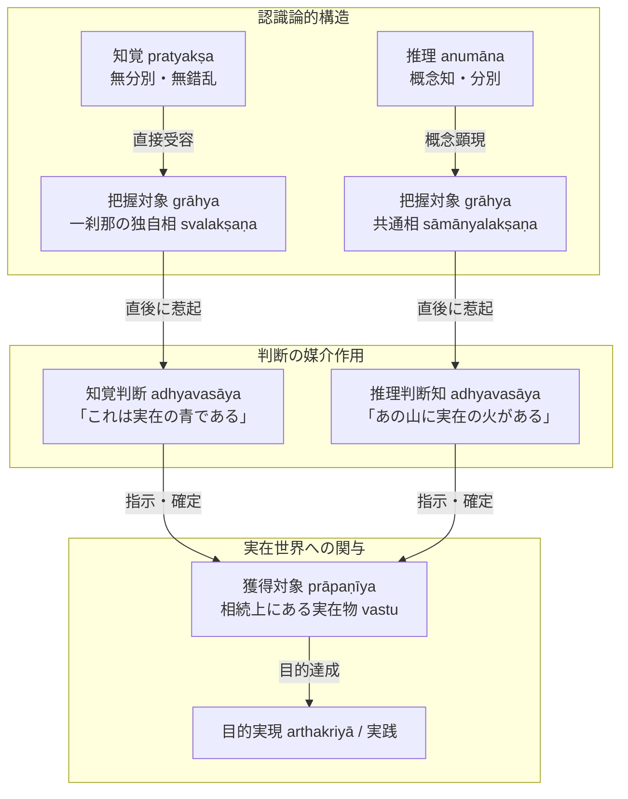

# ダルモーッタラ認識論・論理学の全体構造

カシミール出身の仏教論理学派注釈家ダルモーッタラ（Dharmottara, 法上, ca. 740--800）が構築した認識論・論理学の統合的体系。博士論文『結論』に基づき、その思想体系全体を貫く核心基軸と各部門の連関構造を総括する。

---

## 一、 全体を貫く核心基軸：対象の二分法

ダルモーッタラの認識論・論理学体系全体を貫く基軸は、**「把握対象（grāhya）」**と**「獲得対象（prāpaṇīya）／判断対象（adhyavaseya）」**の厳格な二分法にある（『結論』§1）：

$$\begin{aligned}
\text{認識} &\begin{cases}
\text{知覚 (pratyakṣa)} &\rightarrow \text{把握対象：独自相（svalakṣaṇa, 刹那滅）} \\ \text{推理 (anumāna)} &\rightarrow \text{把握対象：共通相（sāmānyalakṣaṇa, 概念構想）}
\end{cases} \\
&\quad \Downarrow \quad \text{判断知（adhyavasāya）による媒介} \\
\text{実践世界} &\rightarrow \text{獲得対象：刹那の相続上にある実在物（vastu）への関与・目的実現（arthakriyā）}
\end{aligned}$$

---

## 二、 各部門の体系的連関（博士論文各章の総括）

### 1. 正しい認識手段と欺かないこと（第1章）
- **正しい認識手段（pramāṇa）の本質**：人を欺かないもの（[[ja/欺かないこと (avisaṃvādaka)|avisaṃvādaka]]）。
- **対象の獲得（prāpaṇa）**：認識が自ら手にとって対象を与えるのではなく、実在する対象を**判断（adhyavasāya）によって確定し、行動を起こさせて獲得させる**こと。
- **実在物（vastu）の重層性**：究極の実在である独自相（勝義有）と、認識対象として提示される実在物という二重の射程。

### 2. 知覚論と知覚判断（第2章）
- **感官知の本質**：感官知（indriyajñāna）は無分別（kalpanāpoḍha）であり、自らは「これは青である」と決定できない。
- **知覚判断の機能**：感官知の力によって後続する知覚判断が、感官知に顕現した姿を「実在の青」として確定する。
- **分別知の判定基準**：分別（概念知）の本質は**「近在しない対象の顕現（asannihitārthapratibhāsa）」**にあり、眼前にある対象の独自相そのものは顕現しない。

### 3. 推理論と非認識因（第3章）
- **非認識因（anupalabdhi）の成立根拠**：対象の単なる「見えないこと」ではなく、**「認識条件が完備しているにもかかわらず認識されないこと」**に基づく。
- **知覚可能性の二重性**：条件付き知覚可能性と本質的知覚可能性。
- **付託の構造（三種のモデル）**：非存在そのものは実在物（vastu）ではないが、認識条件の完備した基体（場所）に非存在を付託（adhyavasāya）することにより、実践的な非存在の行動（否定判断・言明・回避行動）を成立させる。

### 4. 主張論と疑似主張（第4章）
- **主張（pakṣa）の自性**：
  1. 自己の本性のみによって望まれること（svarūpeṇaiva iṣṭa）
  2. 立論者自身によって望まれること（svayam iṣṭa）
  3. 妨げられないこと（anirākṛta）
- **四種の疑似主張（pakṣābhāsa）の論駁**：知覚・推理・世間・自言語による排斥を精緻に体系化し、論証に値する正当な論題と非主張（apakṣa）を厳格に弁別。

### 5. 論証式（他者のための推理）の理解（第5章）
- **能証（sādhana）の定義**：三相を具えた証因の言明。言語表現それ自体は認識ではないが、他者に推理知を生じさせる直接的原因であるため「推理」と呼ばれる（原因における結果の比喩）。
- **言明順序の必然性**：普遍的法則である「遍充関係（vyāpti）」を先に言明し、次いで具体的基体への適用である「主題所属性（pakṣadharmatā）」を言明する順序こそが、聞き手の認識メカニズムに合致する演繹の必然的形式。
- **帰謬論証（prasaṅga）の還元**：帰謬論証を帰謬還元論証（prasaṅgaviparyaya）へと還元し、不都合な帰結の否定を真の正因とすることで、完全な論証能力（sādhanatva）を付与する。

---

## 三、 思想史的到達点

ダルモーッタラの体系は、ディグナーガに始まりダルマキールティによって展開された仏教認識論・論理学を、**「徹底した刹那滅実在論」と「概念を介した日常実践の成立」という二律背反を調停する精緻な認識構造**として完成させた。後代のジュニャーナシュリーミトラ、ラトナキールティ、モークシャカーラグプタらは、このダルモーッタラの「把握対象／判断対象（獲得対象）」の図式を直接継承・発展させていくこととなる。

---

## 四、 典拠
- 博士論文『結論』（pp. 171--174）
- ダルモーッタラ『正理一滴論注』（*Nyāyabinduṭīkā*）
- ダルモーッタラ『量決択注』（*Pramāṇaviniścayaṭīkā*）

## 五、 関連概念
- [[ja/正しい認識手段 (pramāṇa)|正しい認識手段 (pramāṇa)]]
- [[ja/把握対象と獲得対象 (grāhya-prāpaṇīya)|把握対象と獲得対象 (grāhya-prāpaṇīya)]]
- [[ja/知覚判断 (adhyavasāya)|知覚判断 (adhyavasāya)]]
- [[ja/非認識因における付託の構造（三種のモデル）|非認識因における付託の構造（三種のモデル）]]
- [[ja/他者のための推理と論証式 (parārthānumānaとsādhana)|他者のための推理と論証式 (parārthānumānaとsādhana)]]
- [[ja/論証式における言明順序（遍充関係と主題所属性）|論証式における言明順序（遍充関係と主題所属性）]]
- [[ja/ダルモーッタラ (Dharmottara)|ダルモーッタラ (Dharmottara)]]
