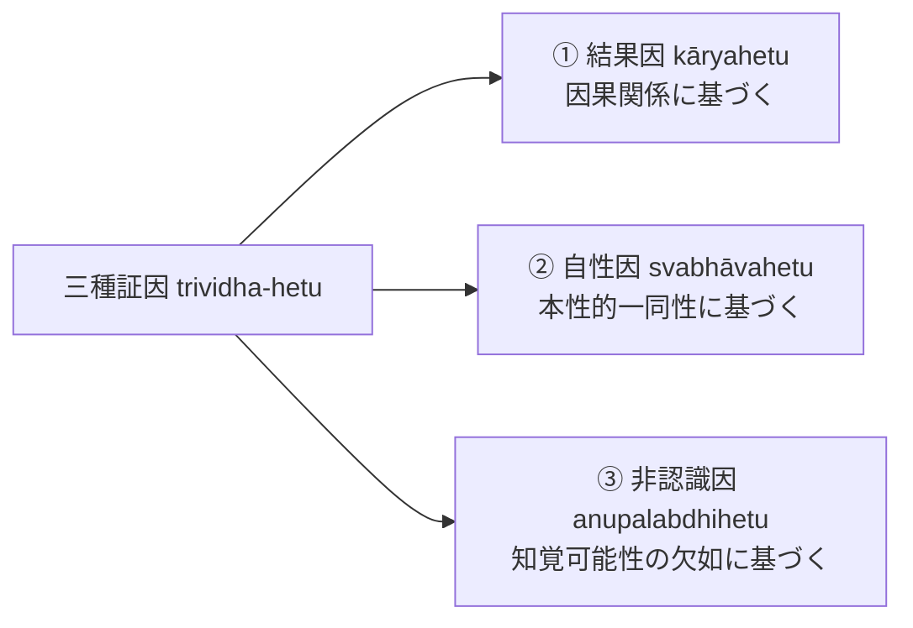

# 三種証因 (trividha-hetu)

ダルマキールティが『正理一滴論』第二章等で定式化した、正しい推論を導出する三種類の正因（『序論』§0.6, NB 2.11--17）。すべての正因は所証との間に[[ja/本質的結合関係 (svabhāvapratibandha)|本質的結合関係]]を有する。

## 一、 三種の分類と論証式

### 1. 結果因（kāryahetu）
- **原理**：結果の存在から、それを必然的に産み出す原因の存在を推論する。
- **論証式**：
  - 【主張】あの山に火がある。
  - 【証因】煙のゆえに。
  - 【喩例】煙のある所には火がある（かまど）。火のない所には煙はない（湖）。

### 2. 自性因（svabhāvahetu）
- **原理**：一方の自性（X）が、それ自身の存在のみに従う他方の自性（Y）を導出する証因（PVin II 53ab）。
- **論証式**：
  - 【主張】これは木である。
  - 【証因】シンシャパー樹のゆえに。
- **アポーハ論的背景**：目の前の物体を石・草ではないと考える人にとって「木性」が自性であり、桃・リンゴではないと考える人にとって「シンシャパー樹性」が自性である。シンシャパー樹性が木性に遍充されているため自性因となる。

### 3. 非認識因（anupalabdhihetu）
- **原理**：認識条件（照明、視力、意向等）が完備しているにもかかわらず、知覚可能な対象が知覚されないことから、その対象の非存在を推論する。
- **例**：目の前の机の上に瓶が知覚されないことによって、瓶の非存在を確定する。

---

## 関連概念
- [[ja/因の三相 (trairūpya)|因の三相 (trairūpya)]]
- [[ja/本質的結合関係 (svabhāvapratibandha)|本質的結合関係 (svabhāvapratibandha)]]
- [[ja/比量 (anumāna)|比量 (anumāna)]]
- [[ja/正理一滴論 (Nyāyabindu)|正理一滴論 (Nyāyabindu)]]