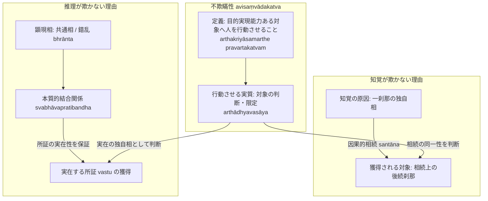

# 不欺瞞性 (avisaṃvādakatva, 人を欺かないこと)

仏教論理学・認識論において、[[ja/正しい認識手段 (pramāṇa)|正しい認識手段（pramāṇa）]]の本質的規定とされる根本概念。サンスクリット：*avisaṃvādakatva*（人を欺かないこと、無詐妄性）。博士論文『第1章 正しい認識手段』§1.2 に基づき、知覚と推理における欺かない理由の差異と論理構造を規定する。

## 一、 定義とダルモーッタラの解釈（PV 2.1 と NBṬ ad NB 1.1）

- **ダルマキールティの定義（『量評釈』PV 2.1）**：
  > *"pramāṇam avisaṃvādi jñānam arthakriyāsthitiḥ | avisaṃvādanam ..."*
  > 正しい認識とは欺かない認識であり、欺かないこととは目的実現が確定していることである。
- **ダルモーッタラの革新解釈（『正理一滴論注』NBṬ ad NB 1.1）**：
  ダルモーッタラは「目的実現が確定していること」を、**「目的実現能力のある対象に対して人を行動させること（arthakriyāsamarthe pravartakatvam）」**と読み替える。
  さらに、「行動させる（pravartakatva）」の実質を次のように厳密に規定する（NBṬ on NB 1.1）：
  > *"kevalaṃ pravartakatvaṃ pravṛttiviṣayadarśakatvam eva | ... viṣayīkaraṇaṃ ca tasyaiva jñānasyārthādhyavasāyakatvam | na hi jñānaṃ puruṣaṃ haṭhena pravartayati | arthādhyavasāyād eva pravṛttir bhavati |"*
  > 単に「行動させること」とは「行動対象を示すこと」に他ならない。……そして［対象を］行動の対象とすることとは、まさにその認識が対象を判断・限定すること（arthādhyavasāyakatva）に他ならない。実に認識は人間を力ずくで行動させるのではない。まさに［認識による］対象の判断・限定から行動が生じるのである。

---

## 二、 知覚が欺かない理由（因果的相続の同一性）

- **刹那滅の難問**：
  知覚が生起した瞬間、知覚の原因となった対象の一刹那（独自相）は直ちに消滅しているため、その対象自体を直接獲得することは不可能である。
- **解決（相続の同一判断）**：
  > *"yatrārthe 'dhyavasāyo na tasya sākṣātprāptiḥ | tadarthakṣaṇasya vinaṣṭatvāt | api tu tajjātīyasya kṣaṇāntarasya prāptir bhavati | sā ca prāptir ucyate | santānasyaikātmatvādhyavasāyāt |"* (NBṬ on NB 1.1)
  > 判断・限定がなされる対象そのものが直接に獲得されるのではない。なぜなら、その対象の刹那は消滅しているからである。そうではなく、それと同種の別の刹那（tajjātīyaṃ kṣaṇāntaram）が獲得されるのである。そして、相続（santāna）が同一のものであると判断・限定されることから、それが「獲得」と呼ばれるのである。
- 知覚の原因となった対象と、行動によって獲得される後続の対象は、**同一の因果的相続（santāna）**に属しており、[[ja/知覚判断 (adhyavasāya)|知覚判断]]がこれを同一物として限定することによって、知覚は人を欺かない。

---

## 三、 推理が欺かない理由（本質的結合関係）

- **推理の錯乱性（bhrānta）**：
  推理知に現れる把握対象は[[ja/共相 (sāmānyalakṣaṇa)|共通相（概念）]]であり、客観的実在（独自相）そのものではないため、推理は厳密には錯乱（bhrānta）である。
- **欺かない根拠**：
  > *"anumānaṃ tu liṅgadarśanabalād arthādhyavasāyakam | na cābhrāntam | sāmānyalakṣaṇaviṣayatvāt | bhrāntam api pravartakatvāt pramāṇam | tadarthakriyāsamarthārthapravartakatvāc cāvisaṃvādakam |"* (NBṬ on NB 1.1)
  > 推理は証相（証因）の知覚の力によって対象を判断・限定する。そして［推理は］錯乱がないわけではない。なぜなら共通相を対象とするからである。［しかし、推理は］錯乱しているとしても、［人を行動対象へと］行動させるがゆえに正しい認識手段であり、その目的実現能力のある対象に対して人を行動させるがゆえに「人を欺かないもの（avisaṃvādaka）」である。
- 推理は、証因（煙）と所証（火）の間に存する**[[ja/本質的結合関係 (svabhāvapratibandha)|本質的結合関係（svabhāvapratibandha）]]**に基づいている。証因の実在性によって所証の実在性が論理的に保証されているため、推理に基づく行動は最終的に実在する所証（火の独自相）の獲得に至り、人を欺かない。

---
## 典拠
- 博士論文『第1章 正しい認識手段』§1.2「認識手段が欺かない理由」
- ダルマキールティ『量評釈』（*Pramāṇavārttika* II.1）
- ダルモーッタラ『正理一滴論注』（*Nyāyabinduṭīkā* ad NB 1.1）

## 関連概念
- [[ja/正しい認識手段 (pramāṇa)|正しい認識手段 (pramāṇa)]]
- [[ja/目的実現と目的実現能力 (arthakriyāとarthakriyāsāmarthya)|目的実現と目的実現能力 (arthakriyāとarthakriyāsāmarthya)]]
- [[ja/知覚判断 (adhyavasāya)|知覚判断 (adhyavasāya)]]
- [[ja/本質的結合関係 (svabhāvapratibandha)|本質的結合関係 (svabhāvapratibandha)]]
- [[ja/把握対象と獲得対象 (grāhya-prāpaṇīya)|把握対象と獲得対象 (grāhya-prāpaṇīya)]]
- [[ja/現量 (pratyakṣa)|現量 (pratyakṣa)]]
- [[ja/比量 (anumāna)|比量 (anumāna)]]
