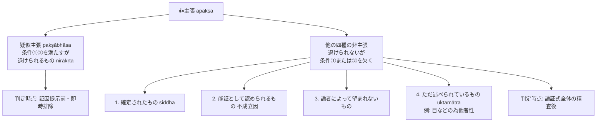

# 主張の定義と非主張（pakṣaとapakṣa）

仏教論理学における「他者の為の推理（論証式）」において、証明されるべき命題である「主張（所証 *pakṣa / sādhya*）」の定義と、それから排除される五種の「非主張（*apakṣa*）」の構造。博士論文『第三章 他者の為の推理』§3.0, §3.2 に基づく厳密な概念抽出。

## 一、 ダルマキールティによる「主張」の定義と目的

ダルマキールティは『正理一滴論』において、主張（所証）を次のように定義した：

> *"svarūpeṇaiva svayam iṣṭo 'nirākṛtaḥ pakṣa iti ||"*（NB 3.38）
> （「主張（所証）」とは、① それ自身（所証）としてのみ、② 〔論者〕自身によって望まれるものであり、③ 〔知覚などによって〕退けられないものである。）

### 主張の定義が述べられる理由（NBṬ 176, 8--10）
仏教論理学において、主張そのものには論証能力（能証作用）はなく、証因の適用領域を示すものに過ぎないため、論証式において必ずしも言明される必要のない支分である。
それにもかかわらず定義が示される理由は、**「主張ではないものを主張と誤解し、主張であるものを非主張と誤解する対論者の謬見を排除するため（sādhyāsādhyavipratipattinirākaraṇārtham）」**である。

---

## 二、 非主張（apakṣa）の五分類（NB 3.54）

定義の各要素の否定・逆転（viparyaya）により、以下の五種の「非主張」が排除される：

1. **このように確定されたもの（siddha）**：
   ある学術書等で既に証明済みの事柄（例：煙から火を論証する際、学術書で確定されている「寒さの非存在」等）。論者が現に証明しようと望むものではない。
2. **能証として認められるもの（asiddha sādhanatvenābhimata）**：
   不成立の証因（例：音の無常性に対する「所見性」）。証明されるべき状態にあるが、所証としてのみ望まれるのではなく、能証として述べられている。
3. **論証時に論者によって証明が望まれないもの（svayaṃ vādinā tadā sādhayitum aniṣṭa）**：
   文脈上、論者が意図していない属性（例：無常性を証明すべき論争で述べられた「常住性」）。
4. **ただ述べられているもの（uktamātra）**：
   表面上の言葉として発せられているが、真の所証ではないもの（§3.2.2 参照）。
5. **退けられるもの（nirākṛta）＝ [[ja/四種の疑似主張（pakṣābhāsa）|疑似主張（pakṣābhāsa）]]**：
   知覚・推理・言語常識・自身の言葉によって論理的に破綻するもの。

---

## 三、 「疑似主張」と「他の非主張」の相違（§3.2.1）

博士論文は、従来混同されがちであった「疑似主張（5）」と「他の非主張（1--4）」の根本的相違を二点において解明する：

### 1. 定義要件の充足関係
- **疑似主張（5）**：
  条件①（所証としてのみ）と条件②（論者自身が望む）を満たすが、**条件③（退けられないこと）を満たさない**。
- **他の非主張（1--4）**：
  条件③（退けられないこと）を満たすが、**条件①または条件②のいずれかを満たさない**。

### 2. 判定の時点と論証式の構造
- **疑似主張の判定**：
  **論証の開始前（証因・喩例の提示前）**に、命題そのものの不合理さとして直ちに退けられる（無益な論証手続を未然に排除する実用的機能）。
- **他の非主張の判定**：
  **論証式全体（主張・証因・喩例）の論理的連関が精査された後**に初めて確定される。

---

## 四、 「ただ述べられているもの（uktamātra）」の典型例（§3.2.2）

サーンキヤ学派によるプルシャ（純粋精神・アートマン）存在論証に対する批判：

```
【主張】目などは他者のためのものである（parārthāḥ）。
【証因】集積物であるから（saṃghātatvāt）。
【喩例】寝台や椅子などの用具の如し。
```

- **分析**：
  サーンキヤ学派が論争文脈において真に証明しようと望んでいるのは**「為アートマン性（ātmārthatā, アートマンのためのものであること）」**である。
- しかし「為アートマン性」と「集積物性」の肯定的随伴（同品定有性）は仏教徒には承認されないため、表面上は随伴が成立する**「為他者性（pārārthya）」**を言葉として述べている。
- ダルモーッタラの判定：表面上発語された「為他者性」は**ただ述べられているもの（uktamātra）**に過ぎず、真の主張ではない。



---

## 典拠
- 博士論文『第三章 他者の為の推理』§3.0「緒言」、§3.2「疑似主張と他の非主張」
- ダルマキールティ『正理一滴論』（*Nyāyabindu* 3.38, 3.41, 3.44, 3.47, 3.53--54）
- ダルモーッタラ『正理一滴論注』（*Nyāyabinduṭīkā*）

## 関連概念
- [[ja/四種の疑似主張（pakṣābhāsa）|四種の疑似主張（pakṣābhāsa）]]
- [[ja/比量 (anumāna)|比量 (anumāna)]]
- [[ja/因の三相 (trairūpya)|因の三相 (trairūpya)]]
- [[ja/論証式の革新（五支作法から三支作法へ）|論証式の革新（五支作法から三支作法へ）]]
