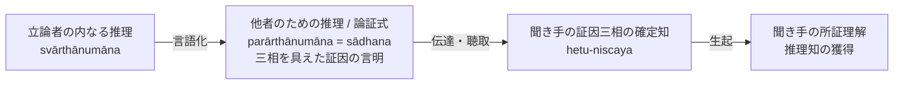

# 他者のための推理と論証式 (parārthānumānaとsādhana)

仏教論理学における論証伝達の理論体系。サンスクリット：*parārthānumāna*（他者のための推理／他利比量）および *sādhana*（能証／論証式）。博士論文『第5章 ダルモーッタラによる論証式理解』§5.1 に基づく厳密な概念・機能の規定。

---

## 一、 定義と本質：言語表現への比喩的転用

### 1. 法称による根本定義（NB 3.1）
> *"trirūpaliṅgākhyānaṃ parārthānumānam"*
> （三相を具えた証因を言明することが、他者のための推理である。）

- **能証（sādhana）との同一性**：
  法称（Dharmakīrti）およびダルモーッタラ（Dharmottara）において、「他者のための推理」と「能証（sādhana, 論証式）」は同義である。自らの内で確定された推論内容を他者に伝達し、他者に正しい認識を生じさせる言語表現全般を指す。

### 2. 「原因における結果の比喩的表現（kāraṇe kāryopacāra）」
本来、「推理（anumāna）」とは心の内にある概念的認識（分別知）であり、言語表現そのものは認識ではない。それにもかかわらず、なぜ言明（ākhyāna）が「推理」と呼ばれるのかについて、ダルモーッタラは次のように説明する（NBT on NB 3.2）：

> 言語による言明は、聞き手の心に「三相を具えた証因の確定」を生じさせ、それを通じて「所証（sādhya）を理解する推理知」を生ぜしめる**直接の原因**である。したがって、結果である認識（推理）の名をその原因である言語表現に重ねて「推理」と呼ぶ（kāraṇe kāryopacāra）。

---
## 二、 主張（pakṣa）言明の不要化と論証式の精緻化

伝統的なインド論理学（ニヤーヤ学派の五支作法：主張・因・喩・適用・結論）およびディグナーガ（陳那）の三支作法（主張・因・喩）では、論証式の冒頭に「主張（宗, pakṣa）」（例：「あの山は火を有する」）を言明することが必須とされていた。

しかし、法称およびダルモーッタラは、**論証式において主張を独立して言明することは本質的に不要である**とした：

1. **証因言明の完備性**：
   正しく「遍充関係（vyāpti）」と「主題所属性（pakṣadharmatā）」が言明されれば、聞き手は論理的必然性によって自ずから所証を理解する。
2. **主張の副次性**：
   主張の言明は、議論の主題（何について論じているのか）を聞き手に指示する便宜的な役割にすぎず、所証を成立させる「論証能力（sādhanatva）」を持たない。論証能力を持つのは唯一「証因の三相の言明」のみである。

---

## 三、 典拠
- 博士論文『第5章 ダルモーッタラによる論証式理解』§5.1「論証式の定義」
- ダルマキールティ『正理一滴論』（*Nyāyabindu* III.1--2）
- ダルモーッタラ『正理一滴論注』（*Nyāyabinduṭīkā* III.1--2）

## 四、 関連概念
- [[ja/比量 (anumāna)|比量 (anumāna)]]
- [[ja/論証式における言明順序（遍充関係と主題所属性）|論証式における言明順序（遍充関係と主題所属性）]]
- [[ja/因の三相 (trairūpya)|因の三相 (trairūpya)]]
- [[ja/主張の定義と非主張（pakṣaとapakṣa）|主張の定義と非主張（pakṣaとapakṣa）]]
- [[ja/帰謬論証と帰謬還元論証 (prasaṅgaとprasaṅgaviparyaya)|帰謬論証と帰謬還元論証 (prasaṅgaとprasaṅgaviparyaya)]]
