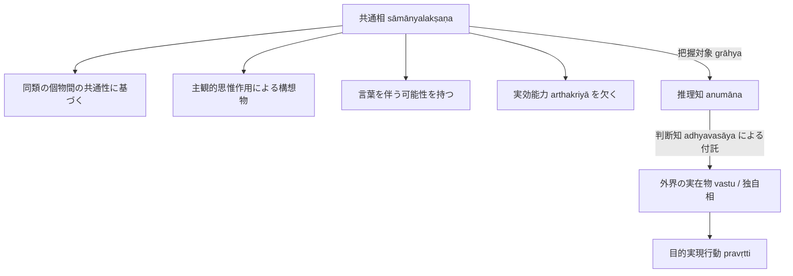

# 共相 (sāmānyalakṣaṇa, 共通相)

仏教論理学・認識論における概念的普遍相。サンスクリット：*sāmānyalakṣaṇa*（共通相）。

## 一、 本質的規定

本質規定：

> **定義**：**同種類の個物間の共通性を根拠として、主観的な思惟作用により構想された、言葉を伴う可能性のある姿。**

- **主観的構想物（分別 kalpanā）**：
  実在物（[[ja/自相 (svalakṣaṇa)|独自相]]）とは異なり、客観的外界に独立して存在する実体ではなく、主観的な思惟作用（構想作用）によって作り出された概念的顕現（pratibhāsa）である。
- **目的実現能力（arthakriyā）の欠如**：
  共通相それ自体は何の因果的作用も生じさせない（例えば、概念上の「火」は熱さをもたらさず、物を燃やすこともできない）。

---

## 二、 認識論における位置づけ：推理の把握対象

1. **推理の把握対象（grāhya）**：
   推理知（[[ja/比量 (anumāna)|比量]]）に直接顕現する把握対象は共通相である。したがって、推理は本質的に概念的認識作用（分別）である。
2. **目的実現への行動と判断知（adhyavasāya）の必要性**：
   人は目的実現を求めて行動するため、作用をもたらさない概念的顕現（共通相）そのものに対して行動することはない。
   推理が正しい認識手段として機能するためには、**推理知の後に、推理知に顕現する火の共通相を外界に実在する火の独自相として判断する判断知（adhyavasāya）**が不可欠となる。
3. **アポーハ（他者の排除）との連関**：
   仏教徒にとって共通相とは実在する普遍（sāmānya）ではなく、他者からの排除（[[ja/アポーハ (anya-apoha)|anya-apoha]]）によって言語的に構成された差異の体系に他ならない。

---

## 典拠
- 『序論』§0.6「導入部」
- ダルマキールティ『量評釈』（*Pramāṇavārttika* III.1--3）
- ダルモーッタラ『正理一滴論注』（*Nyāyabinduṭīkā*）

## 関連概念
- [[ja/自相 (svalakṣaṇa)|自相 (svalakṣaṇa)]]
- [[ja/比量 (anumāna)|比量 (anumāna)]]
- [[ja/把握対象と獲得対象 (grāhya-prāpaṇīya)|把握対象と獲得対象 (grāhya-prāpaṇīya)]]
- [[ja/アポーハ (anya-apoha)|アポーハ (anya-apoha)]]
- [[ja/知覚判断 (adhyavasāya)|知覚判断 (adhyavasāya)]]
- [[ja/真に存在する実在 (vastu)|真に存在する実在 (vastu)]]
