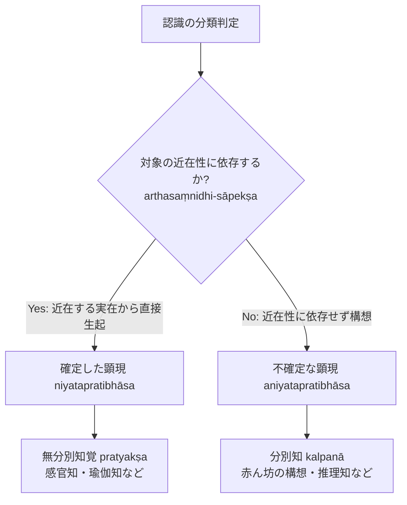

# 分別知の判定基準 (kalpanāとaniyatapratibhāsa)

仏教認識論における概念構想（分別 kalpanā / vikalpa）の定義と、ダルモーッタラによる独自の判定基準。博士論文『第2章 自己の為の推理』§2.1 に基づく厳密な概念分析。

## 一、 分別（kalpanā）の定義の変遷

1. **ディグナーガ（陳那）『量集論』PS 1.3**：
   > *"nāmajātyādiyojanā"*
   > 「名称や種（種類を表す語）などと結びつくもの」
2. **ダルマキールティ（法称）『正理一滴論』NB 1.5**：
   > *"abhilāpasaṃsargayogyapratibhāsā pratītiḥ kalpanā"*
   > 「分別とは、言葉と結合することが可能な顕現を有する認識である」

---

## 二、 ダルモーッタラの解釈（『第2章』§2.1.1）

- **言葉との「結合」（saṃsarga）**：
  一つの認識において、表示対象の形相（ākāra）が表示者である言葉の形相と結び付けられ、**両者が同一のものとして把握されること**。
- **「可能な」（yogya）という限定の意義**：
  生まれた当日の言語協約を習得していない赤ん坊の認識（*bālakasya kalpanā*）は、現時点では言葉と結合していないが、「結合可能な顕現」を有している。この「可能な」という語によって、赤ん坊の分別も分別の枠内に過不足なく包摂される。

---

## 三、 ダルモーッタラ独自の判定基準：「不確定な顕現」

ダルモーッタラは、「言葉と結合可能であること」を客観的に確定する基準として、**「不確定な顕現（aniyatapratibhāsatva）」**という基準を導入する（NBṬ on NB 1.5）：

$$\text{不確定な顕現（aniyatapratibhāsa）} \iff \text{対象の近在性に依存しないこと（arthasaṃnidhinirapekṣatva）}$$

1. **直接知覚（感官知）**：
   目の前にある実在対象（原因）から直接生じるため、その時・処・形相に限定された「確定した顕現（*niyatapratibhāsa*）」を持つ。
2. **分別知（概念構想・推理知）**：
   対象が目の前に現前していなくても（近在性に依存せず）生起するため、「不確定な顕現（*aniyatapratibhāsa*）」を持つ。

### 三つの場面における適用と検証（『第2章』§2.1.2--2.1.4）
- **赤ん坊の認識**：言葉を知らなくても、対象の直接の近在性に縛られない構想作用であるため分別知である。
- **音声による分別知**：音声を対象とする分別知も、直前の感官受容を超えて概念的に把握するため不確定な顕現を持つ。
- **ヨーガ行者の認識**：最高度の瞑想において真実をありのままに捉える瑜伽知覚は、直接の対面受容であり確定した顕現を持つため、無分別（直接知覚）である。

---

## 典拠
- 博士論文『第2章 自己の為の推理』§2.1「分別としての自己の為の推理」
- ダルマキールティ『正理一滴論』（*Nyāyabindu* 1.5）
- ダルモーッタラ『正理一滴論注』（*Nyāyabinduṭīkā* 1.5）

## 関連概念
- [[ja/比量 (anumāna)|比量 (anumāna)]]
- [[ja/現量 (pratyakṣa)|現量 (pratyakṣa)]]
- [[ja/知覚判断 (adhyavasāya)|知覚判断 (adhyavasāya)]]
- [[ja/共相 (sāmānyalakṣaṇa)|共相 (sāmānyalakṣaṇa)]]
- [[ja/真に存在する実在 (vastu)|真に存在する実在 (vastu)]]
