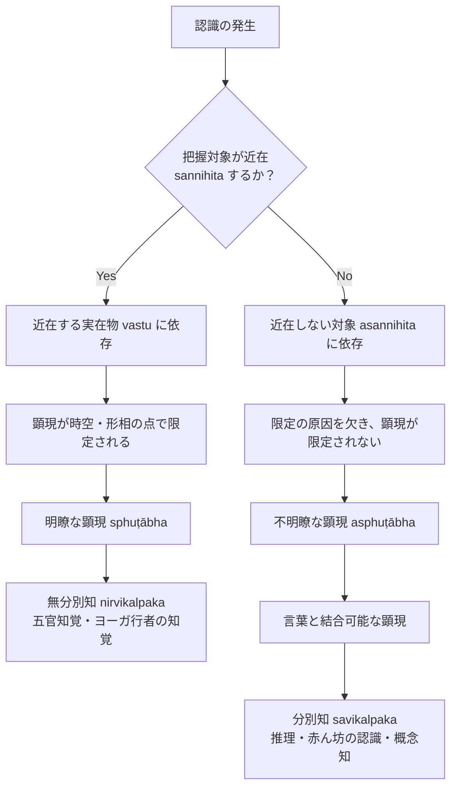

# 分別知の判定基準（近在しない対象の顕現）

ダルモーッタラ（Dharmottara）が『正理一滴論注』（NBṬ on NB 1.5）において導入した、分別知（概念構想作用 *vikalpa / kalpanā*）に関する独自の判断基準。博士論文『第二章 自己の為の推理』§2.1 に基づく厳密な概念抽出。

## 一、 問題の所在：ダルマキールティの「分別」定義とその困難

- **ディグナーガの定義**：
  > *"nāmajātyādiyojanā kalpanā"*（PS 1.3cd）
  > （分別とは、名称や種［種類を表す語］などと結びつくものである。）
- **ダルマキールティの再定義**：
  > *"abhilāpasaṃsargayogyapratibhāsā pratītiḥ kalpanā"*（NB 1.5）
  > （分別とは、言葉と結合することが可能な顕現を有する認識である。）
- **定義の意図と困難**：
  ダルマキールティが「可能な（yogya）」を加えたのは、未だ言語協約（saṃketa）を学習していない生後間もない赤ん坊（bāla）の認識も分別の枠内に含めるためである。しかし、「現に言葉と結合していないとき、どうして言葉と結合可能であることが確定できるのか」という反論が生じる。

---

## 二、 ダルモーッタラによる分別の条件置換（§2.1.1）

ダルモーッタラは、「言葉と結合可能であること」を認識論的・存在論的な条件へと論理的に還元・置換する：

$$\text{言葉と結合可能な顕現} = \text{限定されていない顕現} = \text{不明瞭な顕現} = \text{近在しない対象の顕現}$$

1. **結合（saṃsarga）の解釈**：
   一つの認識において、表示対象の形相（abhidheyākāra）が言葉の形相（abhidhānākāra）と一体化・同一視されて把握されること。
2. **限定されていない顕現（aniyatapratibhāsa）**：
   現に存在する把握対象（近在する実在物 vastu）は、時間・空間・形相の点で認識の顕現を「限定」する（色の極微が明瞭な視覚知を生むように）。しかし、分別知は現に近在する対象から生じるのではないため、限定の原因を欠き、顕現が限定されない。
3. **不明瞭な顕現（asphuṭābha）**：
   限定されない顕現は必然的に不明瞭であり、不明瞭であるがゆえに言葉との結合可能性を残している。
4. **究極の判定基準**：
   **「認識の把握対象が近在（現に存在）することに依存するかどうか」**。近在する把握対象に依存しない認識こそが分別知である。

---

## 三、 三つの場面への適用と妥当性の証明（§2.1.2--§2.1.4）

ダルモーッタラはこの判定基準を以下の三つの特殊な場面に適用し、自身の定義の普遍性を論証する：

### 1. 赤ん坊の認識（bālakalpanā, §2.1.2）
生まれたばかりの赤ん坊が乳を飲む際、「現に見ている乳房（これ）」を「以前に認識された乳房（あれ）」と同一視（pūrvadṛṣṭatvena pratyavamṛśati）して口を寄せる。
- 以前に認識された乳房は**現に近在しない（asannihita）**。
- したがって、近在しない対象を把握する認識として、赤ん坊の認識は言語を持たずとも厳密に**分別知**である。

### 2. 音声の認識（§2.1.3）
文法規則の音声（例：*taraptamapau ghaḥ*）を聞く際、表示者（gha）と表示対象（taraP/tamaP）が同時に耳に顕現する。
- 反論：耳識が無分別であるなら、表示者と表示対象の結合を把握して有分別になってしまうのではないか。
- ダルモーッタラの答論：耳識そのものは現に近在する音声の独自相を把握する無分別知である。表示・被表示の関係を把握するのは、言語協約の時点で生じた（今は消滅して近在しない）認識の対象と同一視する後続の**分別知**である。

### 3. ヨーガ行者の認識（yogijñāna, §2.1.4）
ヨーガ行者の直観的認識には、一切の言葉と意味が顕現する。
- 反論：言葉と意味の顕現を持つなら分別知ではないか。
- ダルモーッタラの答論：ヨーガ行者の認識は、言語協約の時点で認識されたものとして対象を把握するのではなく、**現に近在するもののみをありのままに把握する**ため、完全に**無分別知（nirvikalpaka）**である。

---

## 典拠
- 博士論文『第二章 自己の為の推理』§2.1「分別としての自己の為の推理」
- ダルマキールティ『正理一滴論』（*Nyāyabindu* 1.5）
- ダルモーッタラ『正理一滴論注』（*Nyāyabinduṭīkā* on NB 1.5, NB 1.11）
- ドゥルヴェーカミシュラ『正理一滴論注複注』（*Dharmottarapradīpa*）

## 関連概念
- [[ja/正しい認識手段 (pramāṇa)|正しい認識手段 (pramāṇa)]]
- [[ja/現量 (pratyakṣa)|現量 (pratyakṣa)]]
- [[ja/比量 (anumāna)|比量 (anumāna)]]
- [[ja/四種知覚 (caturvidha-pratyakṣa)|四種知覚 (caturvidha-pratyakṣa)]]
- [[ja/真に存在する実在 (vastu)|真に存在する実在 (vastu)]]
- [[ja/知覚判断 (adhyavasāya)|知覚判断 (adhyavasāya)]]
