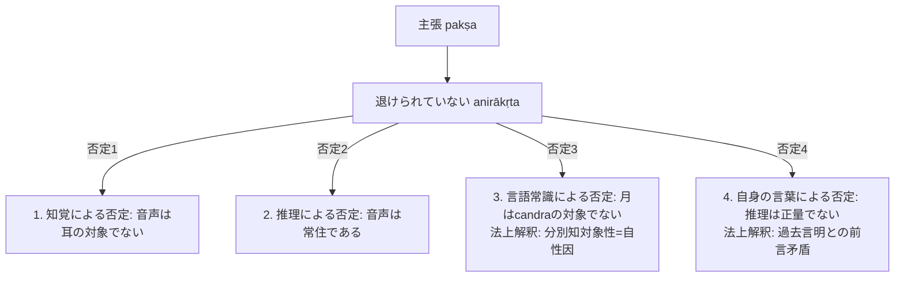

# 四種の疑似主張 (pakṣābhāsa)

他者の為の推理（parārthānumāna）における命題設定（主張 pakṣa / sādhya）の誤謬類型と、ダルモーッタラによる独自解釈（「言語常識＝自性因」および「自身の言葉＝前言矛盾」）。

## 一、 主張（pakṣa）の定義と疑似主張の排除

ダルマキールティ『正理一滴論』NB 3.38：
> *"svarūpeṇaiva svayam iṣṭo 'nirākṛtaḥ pakṣa iti"*
> 「主張（所証）とは、それ自体（所証）としてのみ、論者自身によって望まれるものであり、退けられていないものである」

- **「退けられていない（anirākṛta）」**という限定詞によって、以下の四種によって退けられる命題が「疑似主張（pakṣābhāsa）」として排除される。

---

## 二、 四種の疑似主張（『第3章』§3.1.1）

1. **知覚によって退けられるもの（pratyakṣa-nirākṛta）**：
   - 例：「音声は耳の対象ではない（*aśrāvaṇaḥ śabdaḥ*）」。
   - 音声が聴覚の対象であることは直接知覚によって自明であるため退けられる。
2. **推理によって退けられるもの（anumāna-nirākṛta）**：
   - 例：「音声は常住である（*nityaḥ śabdaḥ*）」。
   - 「作られたものであるから（*kṛtakatvāt*）」という実在物の力に基づく推理（*vastubalapravṛttānumāna*）によって退けられる。
3. **言語常識によって退けられるもの（pratīti-nirākṛta）**：
   - 例：「月（śaśin）は candra という語の表示対象ではない」。
4. **自身の言葉によって退けられるもの（svavacana-nirākṛta）**：
   - 例：「推理は正しい認識手段ではない（*nānumānaṃ pramāṇam*）」。

---

## 三、 ダルモーッタラ独自の解釈（『第3章』§3.1.2）

### 1. 言語常識（pratīti）の自性因解釈
- ダルモーッタラによれば、*pratīti*（常識）とは「世間の言語協約に従って認識されていること（*pratītatva*）」、すなわち**「分別知の対象であること（*vikalpavijñānaviṣayatva*）」**である。
- 分別知の対象であるならば、それは言葉の形象と結合可能であり、協約された語によって表示されうる。
- したがって、「言語常識のゆえに」という証因は、所証属性（語の表示対象であること）に必然的に随伴する**[[ja/三種証因 (trividha-hetu)|自性因（svabhāva-hetu）]]**である。

### 2. 自身の言葉（svavacana）の「前言矛盾」解釈
- **先行研究の通説（自己矛盾派：Tillemans, 谷沢など）**：
  「推理は正しい認識手段ではない」という命題自体が推理であり、「私の言うことは全て嘘である」と同様に一文の中で自己言及的に自らを打ち消す（自己矛盾）。
- **ダルモーッタラの真意**：
  ダルモーッタラはこれを一文内の自己矛盾とは捉えない。論者が言葉を発するとき、発話者はその言葉が真なる内容を持つ（実在物を対象とする）と信じて発している。論者は過去において「推理は正しい認識手段である」と肯定的に述べており、現に述べている「推理は正しい認識手段ではない」という主張は、**論者自身が以前に述べた言明（前言）と矛盾すること（前言矛盾）によって退けられる**と解釈する。

---
## 典拠
- ダルマキールティ『正理一滴論』（*Nyāyabindu* 3.38--52）
- ダルモーッタラ『正理一滴論注』（*Nyāyabinduṭīkā* 3.38--52）

## 関連概念
- [[ja/比量 (anumāna)|比量 (anumāna)]]
- [[ja/論証式の革新（五支作法から三支作法へ）|論証式の革新（五支作法から三支作法へ）]]
- [[ja/因の三相 (trairūpya)|因の三相 (trairūpya)]]
- [[ja/分別知の判定基準 (kalpanāとaniyatapratibhāsa)|分別知の判定基準 (kalpanāとaniyatapratibhāsa)]]
- [[ja/三種証因 (trividha-hetu)|三種証因 (trividha-hetu)]]
