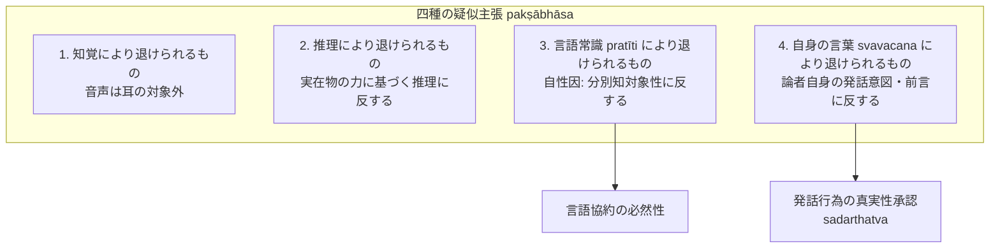

# 四種の疑似主張（pakṣābhāsa）

仏教論理学において、論証式が成立する以前に、主張命題そのものが正当な認識手段や発話規範によって退けられる四つの過失。サンスクリット：*pakṣābhāsa*（似宗・疑似的主張）。博士論文『第三章 他者の為の推理』§3.1 に基づく厳密な概念抽出。

## 一、 四種の分類体系（NB 3.49--52）

ダルマキールティは『正理一滴論』において、以下の四者を「退けられるもの（nirākṛta）」として挙げた：

1. **知覚によって退けられるもの（pratyakṣa-nirākṛta）**：
   - 例：「音声は耳の対象ではない（aśrāvaṇaḥ śabdaḥ）」。
   - 理由：音声が耳の対象であることは直接知覚によって自明に把握されているため。
2. **推理によって退けられるもの（anumāna-nirākṛta）**：
   - 例：「音声は常住である（nityaḥ śabdaḥ）」。
   - 理由：客観的実在の力に基づく推理（vastubalapravṛttānumāna）「作られたものであるがゆえに無常である（壺の如し）」によって退けられるため。
3. **言語常識によって退けられるもの（pratīti-nirākṛta）**：
   - 例：「月（śaśin）は candra という語の表示対象ではない（acandraḥ śaśī）」。
4. **自身の言葉によって退けられるもの（svavacana-nirākṛta）**：
   - 例：「推理は正しい認識手段ではない（nānumānaṃ pramāṇam）」。

---

## 二、 ダルモーッタラにおける「言語常識（pratīti）」の解釈（§3.1.2.1）

ダルモーッタラは「言語常識（pratīti）」を認識論的に厳密に位置づける：

> *"pratīto 'rtha ucyate vikalpavijñānaviṣayaḥ | pratītiḥ pratītatvaṃ vikalpavijñānaviṣayatvam ucyate |"*（NBṬ 183, 5--184, 1）
> （理解された対象とは、分別知の対象のことである。言語常識（pratīti）とは、理解されていること、すなわち分別知の対象であることであると言われる。）

- **論証構造**：
  - 【主張】月（śaśin）は candra という語の表示対象である。
  - 【証因】世間の言語協約に従って月が分別知の対象となっているがゆえに（pratīti）。
- **自性因としての位置づけ**：
  分別知の対象であること（言葉の形象と結合可能であること）は、協約された語の表示対象であることと不可離であり、その存在のみに従うため、言語常識は**[[ja/三種証因 (trividha-hetu)|自性因（svabhāva-hetu）]]**である。

---
## 三、 ダルモーッタラにおける「自身の言葉（svavacana）」解釈の独創性（§3.1.2.2）

先行研究（Tillemans 2000, 谷沢 1987等）は、ダルモーッタラを「自己矛盾派（その命題それ自体が無意味・自己言及的破綻をもたらすという解釈）」と位置づけてきた。
これに対し、博士論文はテキストの精密な読解に基づき、**ダルモーッタラが「前言矛盾・発話行為に基づく否定」の立場をとっていること**を解明した。

### 1. 言葉の有意義性（sadarthatva）と発話前提
- 人が言葉を発するとき、話者は自らの言葉が真なる内容（実在物を対象とすること sadarthatva）を持つと信じ、相手にそれを正しく知らせようとして発話する。
- 「私の言うことは全て嘘である（sarvaṃ mithyā bravīmi）」と述べる者ですら、この文自体は真なる内容として伝達されることを欲して発話している。

### 2. 「推理は正量ではない」が退けられるメカニズム
- 論者が「推理は正しい認識手段ではない」と発話する行為そのものが、「言葉に基づく認識（推理）は真なる内容を持つ」という発話者の承認を不可避の前提としている。
- 過去に「推理は正しい認識手段である」と承認・発話した事実（論者自身の言葉 svavacana）から推測される真実性が、現に主張されている「推理の非正量性」を直接に妨げる。
- したがって、単なる命題の論理的パラドックスではなく、**論者自身が行った発話行為とその意図（前言）との衝突によって退けられる**。

---

## 典拠
- 博士論文『第三章 他者の為の推理』§3.1「疑似主張について」
- ダルマキールティ『正理一滴論』（*Nyāyabindu* 3.48--52）
- ダルモーッタラ『正理一滴論注』（*Nyāyabinduṭīkā* on NB 3.48--52）
- Tom Tillemans 2000, *Scripture, Logic, Language: Essays on Dharmakīrti and his Tibetan Successors*
- 谷沢淳 1987「Dharmottaraのsvavacananirākṛta解釈」

## 関連概念
- [[ja/主張の定義と非主張（pakṣaとapakṣa）|主張の定義と非主張（pakṣaとapakṣa）]]
- [[ja/比量 (anumāna)|比量 (anumāna)]]
- [[ja/分別知の判定基準（近在しない対象の顕現）|分別知の判定基準（近在しない対象の顕現）]]
- [[ja/三種証因 (trividha-hetu)|三種証因 (trividha-hetu)]]
- [[ja/ダルモーッタラ (Dharmottara)|ダルモーッタラ (Dharmottara)]]
