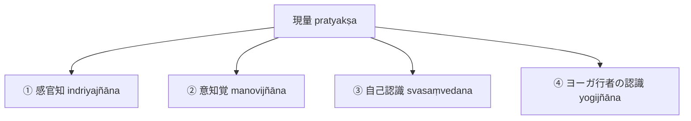

# 四種知覚 (caturvidha-pratyakṣa)

ダルマキールティ（Dharmakīrti）およびダルモーッタラ（Dharmottara）が認める、概念構想を離れ（kalpanāpoḍha）迷乱のない（abhrānta）四つの直接知覚（『序論』§0.6, NB 1.4--1.11）。

## 一、 四種の分類と定義

### 1. 感官知（indriyajñāna）
五感（目、耳、鼻、舌、身）の感官に依拠して生じる知覚。外界の独自相（[[ja/自相 (svalakṣaṇa)|svalakṣaṇa]]）を捉える基礎的認識。

### 2. 意知覚（manovijñāna）
- **生起条件**：先行する感官知を「等無間縁（samanantarapratyaya）」とし、感官知の対象の直後に生じる後続刹那の対象と意根の共働きによって生起する。
- **ダルモーッタラの態度**：林 2012によれば、ダルモーッタラは意知覚を設定する実践的必要性については消極的であったが、ダルマキールティの解釈に最大限忠実であろうとした。

### 3. 自己認識（svasaṃvedana）
- あらゆる心（citta：対象の総相を把握するもの）および心作用（caitta：受・想・思など特殊な状態を把握するもの）が、自らの認識作用そのものを対象として直接知覚すること。
- 苦や楽の感情体験も主観と客観の二元対立を離れた自己認識（直接知覚）とされる（船山 2012）。

### 4. ヨーガ行者の認識（yogijñāna）
- 真実（例えば四聖諦：苦・集・滅・道）を対象とし、最高度の瞑想状態（samādhi）において直観的に生じる知覚（石田 2015, 2017）。

---

## 関連概念
- [[ja/現量 (pratyakṣa)|現量 (pratyakṣa)]]
- [[ja/知覚判断 (adhyavasāya)|知覚判断 (adhyavasāya)]]
- [[ja/自相 (svalakṣaṇa)|自相 (svalakṣaṇa)]]
- [[ja/ダルモーッタラ (Dharmottara)|ダルモーッタラ (Dharmottara)]]