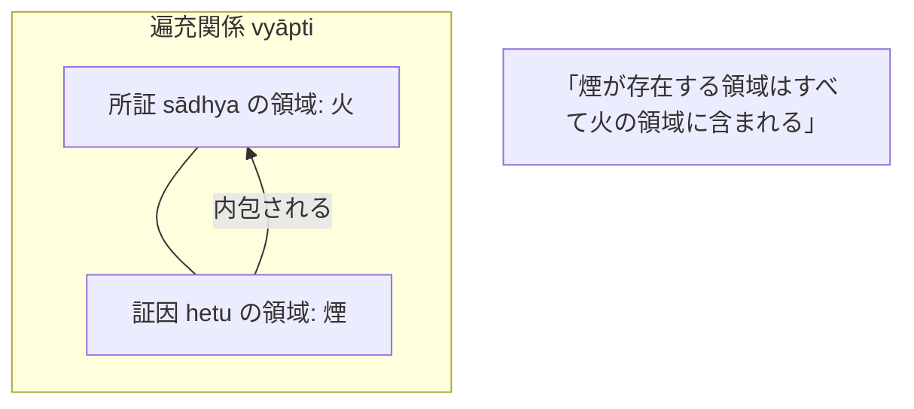

# 因の三相 (trairūpya)

仏教論理学において、推論（[[ja/比量 (anumāna)|比量]]）を成立させる正因（hetu）が満たさなければならない三つの論理的条件（『序論』§0.6）。

## 一、 三相の定義

| 条件 | サンスクリット | 名称 | 内容（『序論』原文による規定） | 煙と火の例 |
| :--- | :--- | :--- | :--- | :--- |
| **第一相** | pakṣadharmatva | **宗法性** | 所証（火）の基体（山）において証因（煙）が存在すること。 | あの山に煙がある。 |
| **第二相** | anvayavyāpti | **同品定有性** | 所証を持つ同類群（かまど等）に**のみ**証因が存在すること。 | 煙がある所には必ず火がある。 |
| **第三相** | vyatirekavyāpti | **異品遍無性** | 所証を持たない異類群（湖等）に証因は**決して存在しない**こと。 | 火のない所には決して煙はない。 |

---

## 二、 遍充関係（vyāpti）の本質

- **等価値性**：
  第二相（肯定的随伴 anvaya）と第三相（否定的随伴 vyatireka）は論理的に等価値（対偶関係）であり、一方が満たされれば他方も必然的に満たされる。
- **遍充の幾何学的定義**：
  二者の間の遍充関係とは、**一者（所証 sādhya）の存在領域が、他者（証因 hetu / sādhana）の存在領域を完全に覆い尽くすこと**である。両者の領域が完全に一致する場合も遍充関係が認められる。

---

## 三、 ダルマキールティによる論証式の簡略化

- 伝統的な[[ja/論証式の革新（五支作法から三支作法へ）|三支作法]]（主張・証因・喩例）に対し、ダルマキールティは**「遍充関係」**と**「主題所属性（宗法性）」**の二つを明示すれば十分であり、主張（宗）を独立して立てる論理的必要性はないとした（稲見 2018）。

---

## 関連概念
- [[ja/三種証因 (trividha-hetu)|三種証因 (trividha-hetu)]]
- [[ja/比量 (anumāna)|比量 (anumāna)]]
- [[ja/本質的結合関係 (svabhāvapratibandha)|本質的結合関係 (svabhāvapratibandha)]]
- [[ja/論証式の革新（五支作法から三支作法へ）|論証式の革新]]