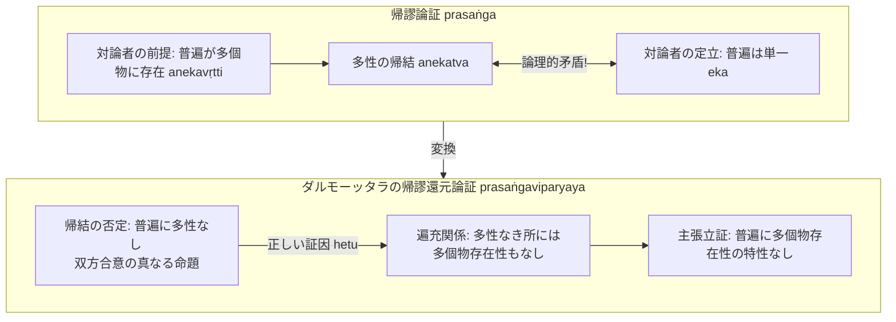

# 帰謬論証と帰謬還元論証 (prasaṅgaとprasaṅgaviparyaya)

ダルモーッタラ（Dharmottara）論理思想における独自的貢献の一つ。サンスクリット：*prasaṅga*（帰謬論証）および *prasaṅgaviparyaya*（帰謬還元論証）。『序論』§0.7.5 に基づく学説史的・論理学的整理。

## 一、 定義と両者の相違

- **帰謬論証（prasaṅga）**：
  反論者が構想している体系内に、純粋な論理的手続きによって論理的矛盾を発生させ、その体系の整合性と体系内の定立を破壊する手段。
- **帰謬還元論証（prasaṅgaviparyaya）**：
  帰謬論証における帰結が真ではないことに基づいて、**その帰結の否定を証因（hetu）とし、対論者のみが認めている事柄を否定する論証**。

---

## 二、 ダルマキールティとダルモーッタラの理解の懸隔（谷 1983）

- **ダルマキールティの立場**：
  帰謬論証には論証機能があるが、正しい論証（自立的論証）ではない。
- **ダルモーッタラの立場**：
  帰謬論証を**帰謬還元論証（prasaṅgaviparyaya）に変換させることで、一定の条件下で論証の性格を与える**。

---

## 三、 『量決択注』における具体例（普遍の単一性批判）

他学派（勝論派・正理派等）は普遍（sāmānya）を「単一なる実在（eka）」と認める一方、それが「多くの個物に存在する（anekavṛtti）」と主張する。ダルモーッタラはこの矛盾を突く：

### 1. 帰謬論証（prasaṅga）
> 「普遍などが〔対論者説に従って仮に〕多くの個物に存するとすれば（anekavṛtti）、〔討論者にも〕認められないが、〔単一性を本性とするはずの普遍などは〕多性を有することになろう。」（PVinṬ, 岩田 1993: 439）

- **解説**：多くの個物に存在することは多性（anekatva）を必然的に導くが、これは対論者が認める単一性（ekatva）と正面から衝突する。

### 2. 帰謬還元論証（prasaṅgaviparyaya）
> - 【主題所属性】普遍には、多性がない。
> - 【遍充関係】多性のないところに多個物存在性もない。
> - 【主張】故に普遍には多くの個物に存在するという特性がない。（岩田 1993: 440）

- **解説**：帰謬論証における「多くの個物に存在すること」は仏教徒にとって成立しないため正因ではない。しかし帰謬還元論証において**「多性の否定（多性がないこと）」は仏教徒・対論者双方が承認する事実であるため、正しい証因となる**。多性の否定が多個物存在性の否定によって遍充されているため、対論者の説を決定的に論破・否定できる。

---

## 四、 プラジュニャーカラグプタからの批判と論点（岩田 1993）

- **ダルモーッタラ**：
  帰謬還元論証の論証因が[[ja/純粋否定 (prasajya-pratiṣedha)|純粋否定]]から構成されるならば、**主題（基体）が実際には存在しない対象（例えばアートマン我）である場合にも、本来的論証因になり自説の定言が可能である**。
- **プラジュニャーカラグプタ（Prajñākaragupta）**：
  立論者にとって主題（アートマン等）が実在しない場合、帰謬還元論証の因は本来的論証因にならず矛盾の指摘にとどまる。主題が実在する場合（山など）にのみ自立的論証になり得ると批判。

---

## 典拠
- 『序論』§0.7.5「ダルモーッタラの帰謬論証理解」
- ダルモーッタラ『量決択注』（*Pramāṇaviniścayaṭīkā*）
- 谷貞志 1983「帰謬論証について」
- 岩田孝 1993「ダルモーッタラの帰謬論証理解」

## 関連概念
- [[ja/比量 (anumāna)|比量 (anumāna)]]
- [[ja/因の三相 (trairūpya)|因の三相 (trairūpya)]]
- [[ja/本質的結合関係 (svabhāvapratibandha)|本質的結合関係 (svabhāvapratibandha)]]
- [[ja/純粋否定 (prasajya-pratiṣedha)|純粋否定 (prasajya-pratiṣedha)]]
- [[ja/ダルモーッタラ (Dharmottara)|ダルモーッタラ (Dharmottara)]]
