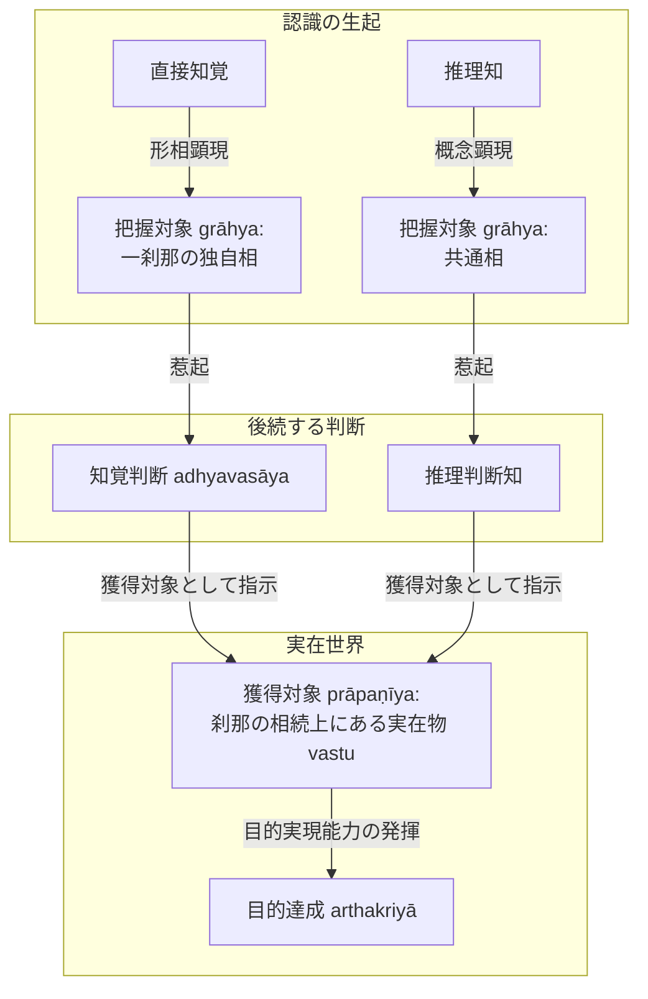

# 把握対象と獲得対象 (grāhya-prāpaṇīya)

ダルモーッタラ（Dharmottara）が仏教認識論において導入した、認識対象に関する画期的な二分法概念（『序論』§0.6, §0.7.9）。サンスクリット：*grāhya*（把握対象）および *prāpaṇīya*（獲得対象）。

## 一、 概念の定義と導入の背景

仏教の根本義である**刹那滅（kṣaṇika）**の立場において、あらゆる実在は刹那ごとに生起し直ちに消滅する。この徹底した刹那滅論から次の認識論的難問が生じる：

> **難問**：知覚が生起した瞬間に知覚された対象刹那はすでに消滅している。人はどのようにして知覚した対象を獲得し、目的を実現することができるのか。

ダルモーッタラは、**「刹那の相続上にある対象こそが獲得され、ある特定の刹那的な対象を獲得することは不可能である」**という点に着目し、以下の二分法を提起した：

1. **把握対象（grāhya）**：
   - 認識が直接その形相（ākāra）をもって生じる対象。
   - **一刹那のもの**である。
   - 知覚においては[[ja/自相 (svalakṣaṇa)|独自相（svalakṣaṇa）]]、推理においては[[ja/共相 (sāmānyalakṣaṇa)|共通相（sāmānyalakṣaṇa）]]がこれに該当する。
2. **獲得対象（prāpaṇīya）**：
   - 認識に後続する判断知（[[ja/知覚判断 (adhyavasāya)|知覚判断]]・推理判断知）によって判断され、行動を通じて実際に獲得される対象。
   - **刹那の相続（santāna）上にある対象**（実在物 [[ja/真に存在する実在 (vastu)|vastu]]）である。

---

## 二、 ダルマキールティ説の再解釈

ダルマキールティは『量評釈』で「知覚と推理はそれぞれ独自相と共通相を対象とする」（PV 3.1--3.3）と述べた。
ダルモーッタラはこれを精緻化し、次のように読み解く：

$$\text{知覚の把握対象} = \text{独自相（一刹那）}, \quad \text{推理の把握対象} = \text{共通相（概念顕現）}$$
$$\text{知覚・推理の獲得対象} = \text{刹那の相続上にある実在物（実在の独自相）}$$

---

## 三、 思想史的意義（『序論』§0.7.9）

1. **ディグナーガ説とダルマキールティ説の統合**：
   中須賀 2019 によれば、ディグナーガとダルマキールティの間には認識手段の対象をめぐる対立が見られたが、ダルモーッタラが「把握対象（grāhya）」と「判断対象（adhyavaseya / 獲得対象）」の区分を導入したことにより、両説が矛盾なく統合された。
2. **後代思想家への決定的影響**：
   ダルモーッタラ以降の主要な仏教認識論者（ジュニャーナシュリーミトラ Jñānaśrīmitra、ラトナキールティ Ratnakīrti、モークシャーカラグプタ Mokṣākaragupta）はこの区分を受け継ぎ、自らの体系の中で改変・発展させた。

---

## 典拠
- 『序論』§0.6「導入部」
- 『序論』§0.7.9「ダルモーッタラの『正しい認識手段』理解」
- ダルモーッタラ『正理一滴論注』（*Nyāyabinduṭīkā*）
- 中須賀 2019『ダルモーッタラにおける認識対象論の変革』

## 関連概念
- [[ja/正しい認識手段 (pramāṇa)|正しい認識手段 (pramāṇa)]]
- [[ja/現量 (pratyakṣa)|現量 (pratyakṣa)]]
- [[ja/比量 (anumāna)|比量 (anumāna)]]
- [[ja/知覚判断 (adhyavasāya)|知覚判断 (adhyavasāya)]]
- [[ja/自相 (svalakṣaṇa)|自相 (svalakṣaṇa)]]
- [[ja/真に存在する実在 (vastu)|真に存在する実在 (vastu)]]
- [[ja/ダルモーッタラ (Dharmottara)|ダルモーッタラ (Dharmottara)]]
