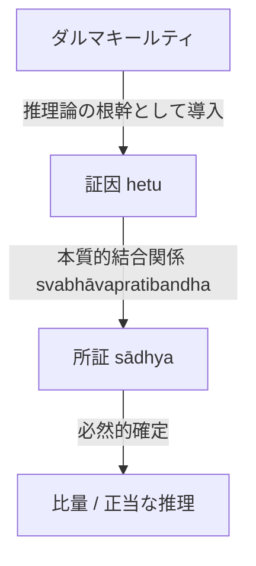

# 本質的結合関係 (svabhāvapratibandha)

ダルマキールティ（Dharmakīrti）の推理論の根幹をなす関係概念。

## 一、 定義と機能
- **所証**（証明されるべきもの）と**証因**（所証の確定を証明する根拠）の間にある客観的結合関係。
- 推理が単なる経験的一致ではなく必然的な正当性を持つための基礎として導入された。

## 二、 概念連関
- **提唱者**：ダルマキールティ（Dharmakīrti）。
- **基礎**：[[ja/比量 (anumāna)|推理]]の妥当性を支える。
- **対象**：所証と証因の結合。

## 三、 概念連関図

