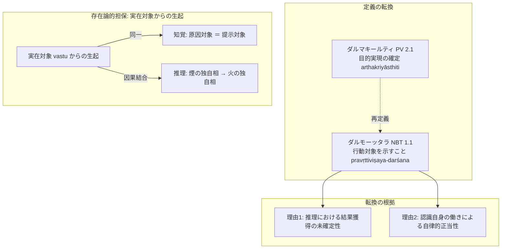

# 欺かないこと (avisaṃvādaka)

仏教論理学・認識論において、ある認識が[[ja/正しい認識手段 (pramāṇa)|正しい認識手段（pramāṇa）]]であるための本質的標識。サンスクリット：*avisaṃvādaka*（人を欺かないもの、不欺誑）。

---

## 一、 法称と法上の解釈転換

ダルマキールティ（法称）とダルモーッタラ（法上）の間には、「欺かないこと」をどう規定するかをめぐって本質的な解釈の転換がある：

| 思想家 | 「欺かないこと」の定義 | 典拠 |
| :--- | :--- | :--- |
| **ダルマキールティ（法称）** | **目的実現が確定していること（arthakriyāsthiti）** | PV 2.1c (*pramāṇam avisaṃvādi gānam arthakriyāsthitiḥ*) |
| **ダルモーッタラ（法上）** | **実在する行動対象を示すこと（pravṛttiviṣaya-darśaka / prāpaka）** | NBT on NB 1.1 (*prāpakatvam eva ca jñānasya prāmāṇyam*) |

---

## 二、 ダルモーッタラが転換を行った二大理由（§1.2.3--§1.2.4）

ダルモーッタラがあえてダルマキールティの「目的実現の確定」という定式化を退け、「行動対象を示すこと」に置き換えた理由は以下の二点にある：

1. **推理における目的実現の未確定性**：
   - 知覚の場合、知覚が生起した瞬間に知覚知が獲得されるため目的は完結しているが、**推理の場合、人が推理に基づいて行動（pravṛtti）を起こしても、障害などの外的要因によって目的の対象（火など）を実際に獲得できるとは限らない**。
   - したがって、「目的実現の確定」を基準にすると、正当な推理まで「欺くもの」として排除されかねない。
2. **認識の自律的正当性（認識自身による正当性の確定）**：
   - 認識が正しい認識手段であることの正当性は、行動の成否という外的結果によって事後的に保証されるのではなく、**認識自身の働き（実在する対象から正しく生起し、時間・空間・形相の限定された実在対象を正しく提示すること）によって自律的に定まる**。

---

## 三、 欺かないことの存在論的根拠：実在対象（vastu）からの生起（§1.2.5）

ダルモーッタラによれば、認識が人を欺かない根本的根拠は、**その認識が「実在する対象（vastu）」から生じたものだからである**：

- **知覚**：
  - 知覚を生起させる原因となる対象（独自相）と、知覚によって示される対象（独自相）は**同一**である。
- **推理**：
  - 推理を生起させる原因となる対象（煙の独自相）と、推理によって示される対象（火の独自相）は異なる。
  - しかし、煙と火の間には**因果関係という[[ja/本質的結合関係 (svabhāvapratibandha)|本質的結合関係（svabhāvapratibandha / tadutpatti）]]**があるため、所証の実在性は原因の実在性によって完全に保証されている。

---

## 典拠
- 『博士論文』第1章§1.2「認識手段が欺かない理由」
- ダルマキールティ『量評釈』（*Pramāṇavārttika* II.1）
- ダルモーッタラ『正理一滴論注』（*Nyāyabinduṭīkā* on NB 1.1）
- 戸崎 1989『仏教認識論の研究』

## 関連概念
- [[ja/正しい認識手段 (pramāṇa)|正しい認識手段 (pramāṇa)]]
- [[ja/目的実現 (arthasiddhi)|目的実現 (arthasiddhi)]]
- [[ja/真に存在する実在 (vastu)|真に存在する実在 (vastu)]]
- [[ja/本質的結合関係 (svabhāvapratibandha)|本質的結合関係 (svabhāvapratibandha)]]
- [[ja/ダルモーッタラ (Dharmottara)|ダルモーッタラ (Dharmottara)]]
