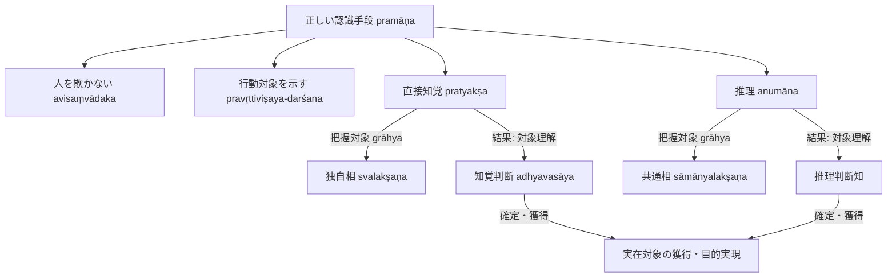

# 正しい認識手段 (pramāṇa)

仏教認識論・論理学における根本概念。サンスクリット：*pramāṇa*（プラマーナ）。『序論』§0.1, §0.6 に基づく体系的規定。

## 一、 本質規定と機能

- **本質規定（人を欺かないこと avisaṃvādaka）**：
  ダルモーッタラによれば、正しい認識手段とは**人を欺かないもの**である。
- **機能（行動対象の指示 pravṛttiviṣaya-darśana）**：
  正しい認識手段とは、**行動対象、すなわち時間・空間・形相の点で限定されている実在する対象（vastu）を示すもの**である。
  人は目的実現（arthakriyā）を求めて行動するため、認識手段が特定の時・処・形相において実在する対象を正しく提示することで、目的達成の行動が可能となる。

---

## 二、 二種の認識手段への限定

仏教論理学派（ディグナーガ以降）が認める正しい認識手段は**二種のみ**である：

1. **[[ja/現量 (pratyakṣa)|直接知覚 (pratyakṣa)]]**：概念構想（分別）を離れて対象の姿をありのままに捉える認識。
2. **[[ja/比量 (anumāna)|推理 (anumāna)]]**：論理に基づいて対象の共通する（概念的な）姿を推し量る認識。

> **二種限定の根拠**：認識対象（所量 prameya）が刹那滅の個別相である「独自相（[[ja/自相 (svalakṣaṇa)|自相]]）」と、概念的構成である「共通相（[[ja/共相 (sāmānyalakṣaṇa)|共相]]）」の二種しか存在しないことによる。

---

## 三、 無我説と認識手段・認識結果の不二性

- **認識主体（pramātṛ）の否定**：
  インド正統派哲学の常識では、認識主体（我 ātman）が認識手段（pramāṇa）によって認識対象（prameya）を捉え、その結果として認識（pramāṇa-phala）が得られるとされる。しかし、無我の立場に立つ仏教徒は認識主体を一切認めない。
- **手段と結果の内在的同一（識三分説）**：
  仏教徒にとって、認識とは諸条件が揃えば成立する一つの出来事に過ぎず、手段と結果の区別は概念的な区別に過ぎない。
  ディグナーガは『量集論』I.10 で唯識派の立場から、認識の「対象・手段・結果」の区別は、**所取（対象の顕現）・能取・自己認識という認識の持つ三相（識三分説）**に過ぎず、独立した実体ではないと明言した。ダルマキールティおよびダルモーッタラもこの理解を継承している。

---

## 四、 認識結果（pramāṇa-phala）としての対象判断

ダルモーッタラによれば、正しい認識手段の果（結果）とは**対象理解（判断知 adhyavasāya）**である：

- **知覚の場合**：感官知の力によって後続する[[ja/知覚判断 (adhyavasāya)|知覚判断]]が「これは目の前にある実在対象についての認識である」と判断・決定する。
- **推理の場合**：推理知に顕現する概念的な共通相を、外界に実在する対象の独自相として判断する判断知が起こる。

---

## 典拠
- 『序論』§0.1「研究の目的」
- 『序論』§0.6「導入部」
- ディグナーガ『量集論』（*Pramāṇasamuccaya* I.10）
- ダルマキールティ『正理一滴論』（*Nyāyabindu* I.1--4）
- ダルモーッタラ『正理一滴論注』（*Nyāyabinduṭīkā*）

## 関連概念
- [[ja/現量 (pratyakṣa)|現量 (pratyakṣa)]]
- [[ja/比量 (anumāna)|比量 (anumāna)]]
- [[ja/知覚判断 (adhyavasāya)|知覚判断 (adhyavasāya)]]
- [[ja/把握対象と獲得対象 (grāhya-prāpaṇīya)|把握対象と獲得対象 (grāhya-prāpaṇīya)]]
- [[ja/真に存在する実在 (vastu)|真に存在する実在 (vastu)]]
- [[ja/ダルモーッタラ (Dharmottara)|ダルモーッタラ (Dharmottara)]]
