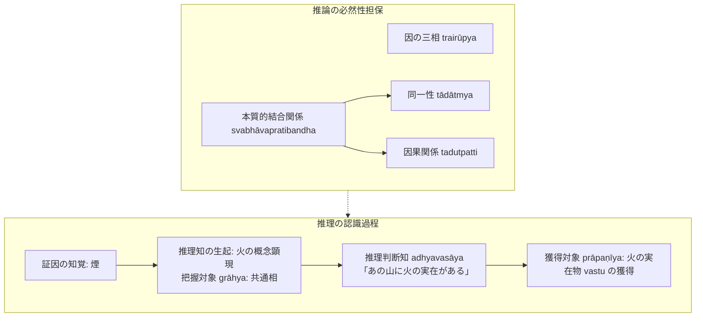

# 比量 (anumāna, 推理)

仏教認識論・論理学における二種の[[ja/正しい認識手段 (pramāṇa)|正しい認識手段（pramāṇa）]]の一つ。論理に基づいて対象の共通する姿を推し量る概念的認識（分別 kalpanā）。『序論』§0.1, §0.6 に基づく体系的規定。

## 一、 本質と認識対象

- **概念的認識（分別）としての性格**：
  推理の把握対象は**[[ja/共相 (sāmānyalakṣaṇa)|共通相（sāmānyalakṣaṇa）]]**である。同種類の個物間の共通性を根拠として主観的思惟作用により構想された姿を顕現させる。
- **把握対象と獲得対象の区別**：
  推理知に顕現する火の姿（共通相）は概念的なものに過ぎず、目的実現能力を持たない。人は概念そのものに対して行動を起こさないため、推理知の直後に**「この推理知はあの山に実在する火の独自相についての認識である」と判断する判断知（adhyavasāya）**が生じる。
  したがって、推理の把握対象は共通相であるが、獲得対象は外界に実在する火の独自相（[[ja/真に存在する実在 (vastu)|vastu]]）である。

---

## 二、 二種の推理（自己の為の推理と他者の為の推理）

推理には二つの形態があるが、**両者に本質的な違いは存在せず、実質は同じ認識である**（『序論』§0.6）：

1. **自己の為の推理（svārthānumāna）**：
   自分自身が証因を観察することによって所証を確定する認識。
2. **他者の為の推理（parārthānumāna）**：
   論証式（主張・証因・喩例）を他者に提示することによって、他者に自分と同様な認識（証因によって推理されるものについての認識）を起こさせる言語表現。

---

## 三、 推理が成立するための論理的根拠

推理が正しい認識手段として人を欺かない根拠は、以下の二つの論理的条件に担保されている：

1. **[[ja/因の三相 (trairūpya)|因の三相 (trairūpya)]]**：
   証因（煙）が満たすべき三条件：
   - 遍是宗法性：所証の基体（山）に証因が存在すること。
   - 同品定有性：所証を持つ同類群（かまど）にのみ証因が存在すること。
   - 異品遍無性：所証を持たない異類群（湖）に証因は決して存在しないこと。
2. **[[ja/本質的結合関係 (svabhāvapratibandha)|本質的結合関係 (svabhāvapratibandha)]]**：
   証因と所証の間にある必然的関係。
   - **同一性（tādātmya）** $\rightarrow$ [[ja/三種証因 (trividha-hetu)|自性因]]（シンシャパー樹 $\rightarrow$ 木）
   - **因果関係（tadutpatti）** $\rightarrow$ [[ja/三種証因 (trividha-hetu)|結果因]]（煙 $\rightarrow$ 火）

---

## 典拠
- 『序論』§0.1「研究の目的」
- 『序論』§0.6「導入部」
- ダルマキールティ『正理一滴論』（*Nyāyabindu* II.1--III.1ff.）
- ダルモーッタラ『正理一滴論注』（*Nyāyabinduṭīkā*）

## 関連概念
- [[ja/正しい認識手段 (pramāṇa)|正しい認識手段 (pramāṇa)]]
- [[ja/因の三相 (trairūpya)|因の三相 (trairūpya)]]
- [[ja/三種証因 (trividha-hetu)|三種証因 (trividha-hetu)]]
- [[ja/本質的結合関係 (svabhāvapratibandha)|本質的結合関係 (svabhāvapratibandha)]]
- [[ja/把握対象と獲得対象 (grāhya-prāpaṇīya)|把握対象と獲得対象 (grāhya-prāpaṇīya)]]
- [[ja/共相 (sāmānyalakṣaṇa)|共相 (sāmānyalakṣaṇa)]]
- [[ja/論証式の革新（五支作法から三支作法へ）|論証式の革新]]
