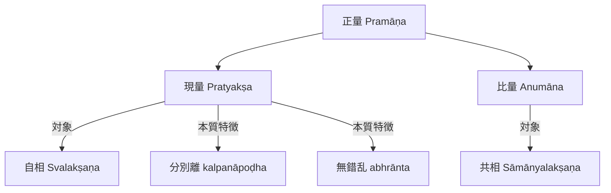

# 現量 (pratyakṣa)

仏教論理学・認識論において、**現量**（サンスクリット：*pratyakṣa*；チベット語：*mngon sum*；英語：*perception / direct cognition*）とは、直接的かつ分別（概念的構成）を交えなき正しい認識手段（二種の正量の一つ）を指す。

## 一、 定義 (Lakṣaṇa)

- **ディグナーガ（陳那）**『集量論』（*Pramāṇasamuccaya* I.3c-d）：
  > *"pratyakṣaṃ kalpanāpoḍham"*（現量は分別を離れたものである）
- **ダルマキールティ（法称）**『[[ja/正理一滴論 (Nyāyabindu)|正理一滴論]]』（*Nyāyabindu* I.4）：
  > *"tatra pratyakṣaṃ kalpanāpoḍham abhrāntam"*（そのうち現量とは、分別を離れ、錯乱なきものである）

## 二、 認識対象 (Prameya)

現量の唯一の認識対象は**[[ja/自相 (svalakṣaṇa)|自相 (svalakṣaṇa)]]**である。
現量は刹那滅なる個別相の直接的な実効力（*arthakriyā*）を感得するのみであり、言語・概念による普遍相（[[ja/共相 (sāmānyalakṣaṇa)|共相]]）を対象としない。

## 三、 論理連関図

