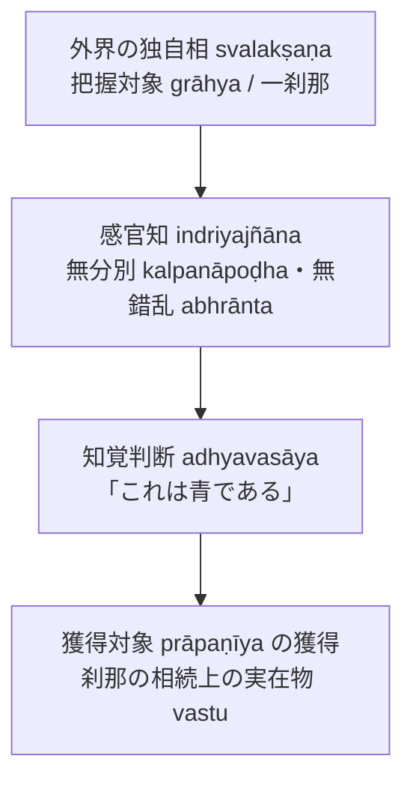

# 現量 (pratyakṣa, 直接知覚)

仏教認識論・論理学における二種の[[ja/正しい認識手段 (pramāṇa)|正しい認識手段（pramāṇa）]]の一つ。概念構想（分別）を離れて対象の姿をありのままに捉える直接知覚。『序論』§0.1, §0.6 に基づく体系的規定。

## 一、 定義の変遷とダルモーッタラの解釈

1. **ディグナーガ（陳那）**『量集論』（*Pramāṇasamuccaya* I.3c-d）：
   > *"pratyakṣaṃ kalpanāpoḍham"*（現量は構想作用［分別］を離れたものである）
2. **ダルマキールティ（法称）**『[[ja/正理一滴論 (Nyāyabindu)|正理一滴論]]』（*Nyāyabindu* I.4）：
   > *"tatra pratyakṣaṃ kalpanāpoḍham abhrāntam"*（そのうち現量とは、構想作用［分別］を離れ、迷乱のない［錯乱なき］ものである）
   - 「迷乱のない（abhrānta）」の追加：眼病者に見える二重の月など、感官の欠陥による錯誤知を無分別であっても知覚から排除するため。
3. **ダルモーッタラ（法上）の再解釈**：
   - 「無錯乱」を単なる感官の正常性にとどめず、**「認識が対象の真実の姿に合致し、実践的な目的の達成（arthakriyā）を導くこと」**として捉え直す。

---

## 二、 認識対象：把握対象と獲得対象

ダルモーッタラは刹那滅論の徹底から、知覚の対象を二層に区別する（『序論』§0.6）：

- **把握対象（grāhya）**：**[[ja/自相 (svalakṣaṇa)|独自相（svalakṣaṇa）]]**。
  時間的・空間的・本性的に他から区別された、一切の概念的規定を欠く**一刹那の実在**。認識はその形相（青など）をもって生じる。
- **獲得対象（prāpaṇīya）**：**刹那の相続（santāna）上にある実在対象**。
  刹那ごとに滅する特定の個別相それ自体を獲得することは不可能なため、行動を通じて獲得されるのは刹那の連続体（実在物 [[ja/真に存在する実在 (vastu)|vastu]]）である。

---
## 三、 認識結果としての「知覚判断」（adhyavasāya）

- **直接知覚の限界**：知覚それ自体は無分別であるため、自ら「これは何であるか」を確定・判断できない。
- **知覚判断の惹起**：感官知の力によって直後に[[ja/知覚判断 (adhyavasāya)|知覚判断]]という概念知が起こる。知覚判断は、感官知に顕現した青の類似形相について「これは目の前にある青についての認識である」と判断する。
- **共働による対象確定**：直接知覚は知覚判断と共働することを通じて、初めて対象を確定し、人を目的実現への行動へと導く。

---

## 四、 四種の知覚（caturvidha-pratyakṣa）

ダルマキールティおよびダルモーッタラは四種の直接知覚を認める（詳細は [[ja/四種知覚 (caturvidha-pratyakṣa)|四種知覚]] を見よ）：

1. **感官知（indriyajñāna）**：五感官に依拠する認識。
2. **意知覚（manovijñāna）**：感官知を等無間縁とし、直後の対象との共働きで生起する認識。
3. **自己認識（svasaṃvedana）**：心（対象把握）および心作用（快・苦等）が自己自身を認識すること。
4. **ヨーガ行者の認識（yogijñāna）**：四聖諦などの真実を最高度の瞑想状態においてありのままに捉える認識。

---

## 典拠
- 『序論』§0.1「研究の目的」
- 『序論』§0.6「導入部」
- ダルマキールティ『正理一滴論』（*Nyāyabindu* I.4--11）
- ダルモーッタラ『正理一滴論注』（*Nyāyabinduṭīkā*）

## 関連概念
- [[ja/正しい認識手段 (pramāṇa)|正しい認識手段 (pramāṇa)]]
- [[ja/知覚判断 (adhyavasāya)|知覚判断 (adhyavasāya)]]
- [[ja/把握対象と獲得対象 (grāhya-prāpaṇīya)|把握対象と獲得対象 (grāhya-prāpaṇīya)]]
- [[ja/自相 (svalakṣaṇa)|自相 (svalakṣaṇa)]]
- [[ja/四種知覚 (caturvidha-pratyakṣa)|四種知覚 (caturvidha-pratyakṣa)]]
- [[ja/比量 (anumāna)|比量 (anumāna)]]
