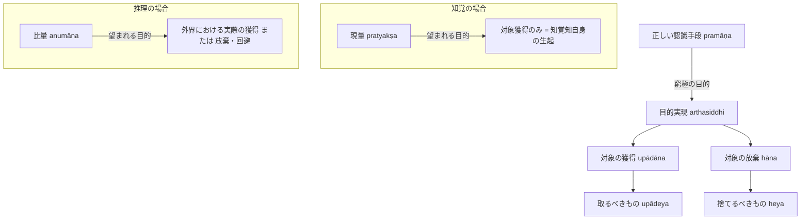

# 目的実現 (arthasiddhi, 獲得と放棄)

ダルモーッタラ（Dharmottara）の認識論における目的論的中核概念。サンスクリット：*arthasiddhi*（目的実現、所期成果の達成）。『博士論文』第1章§1.1に基づく体系的規定。

---

## 一、 定義と二種分類（獲得と放棄）

ダルモーッタラは『正理一滴論注』（NBT on NB 1.1）において、[[ja/正しい認識手段 (pramāṇa)|正しい認識手段（pramāṇa）]]の目的を**「目的実現」（arthasiddhi）**に置く。

> **定義的特質**：
> 人が求める目的の対象（artha）には、**「取るべきもの（upādeya）」**と**「捨てるべきもの（heya）」**の二種類がある。したがって、目的実現（arthasiddhi）も必然的に以下の二つに分かれる：
> 1. **対象の獲得（upādāna）**：望ましい対象を獲得すること。
> 2. **対象の放棄（hāna）**：望ましくない対象から離れ、それを回避・放棄すること。

※ 中立的な対象（upekṣaṇīya, 捨てるべきでも取るべきでもないもの）について、ダルモーッタラは行動の直接の対象外とする（あるいは広義の放棄に包摂される）。

---

## 二、 知覚と推理における目的実現の差異（§1.1.4）

ダルモーッタラは、知覚と推理において人が望む「目的実現」のあり方に重要な区別を認める：

1. **[[ja/現量 (pratyakṣa)|知覚（pratyakṣa）]]の場合**：
   - 人は**「対象の獲得（upādāna）」のみ**を望む。
   - 知覚において「対象を獲得する」とは、外界の事物を手に入れることではなく、**「対象についての知覚知（直接経験）が生じること」そのもの**を指す。直接知覚が成立した瞬間、認識論的な獲得は完結している。
2. **[[ja/比量 (anumāna)|推理（anumāna）]]の場合**：
   - 人は**「対象の獲得」あるいは「対象の放棄」**の双方を望む。
   - 推理知が生じた後、人は論理的に推定された実在物（火など）を**実際に外界において手に入れるか、あるいは危険（火炎や毒など）を回避する行動（pravṛtti）**を起こす。

---

## 三、 概念連関図

---

## 典拠
- 『博士論文』第1章§1.1「目的実現について」
- ダルモーッタラ『正理一滴論注』（*Nyāyabinduṭīkā* on NB 1.1）
- ドゥルヴェーカミシュラ『法上灯』（*Dharmottarapradīpa*）

## 関連概念
- [[ja/正しい認識手段 (pramāṇa)|正しい認識手段 (pramāṇa)]]
- [[ja/欺かないこと (avisaṃvādaka)|欺かないこと (avisaṃvādaka)]]
- [[ja/現量 (pratyakṣa)|現量 (pratyakṣa)]]
- [[ja/比量 (anumāna)|比量 (anumāna)]]
- [[ja/真に存在する実在 (vastu)|真に存在する実在 (vastu)]]
