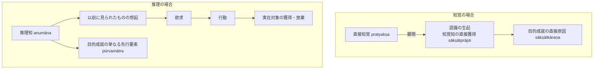

# 目的実現と目的実現能力 (arthakriyāとarthakriyāsāmarthya)

仏教論理学・認識論における実在性と認識妥当性の根幹概念。サンスクリット：*arthakriyā*（目的実現・効果的作用）および *arthakriyāsāmarthya*（目的実現能力）。博士論文『第1章 正しい認識手段』§1.1 に基づく厳密な概念分析。

## 一、 術語の複合語解釈（NBṬ on NB 1.15）

ダルモーッタラは『正理一滴論注』において次のように複合語を文法的に解釈する：

> *"arthyata ity arthaḥ | heya upādeyaś ca | heyo hi hātum iṣyata upādeyaś ca upādātum | arthasya prayojanasya kriyā niṣpattiḥ | tasyāṃ sāmarthyaṃ śaktiḥ |"*
> 
> artha（目的・対象）とは求められるもの（arthyate）を意味し、それは「放棄されるべきもの（heya）」と「獲得されるべきもの（upādeya）」である。実に放棄されるべきものは放棄しようと望まれ、獲得されるべきものは獲得しようと望まれる。
> 目的（artha = prayojana）の実現（kriyā = niṣpatti）、その実現に対する能力（sāmarthya = śakti）を意味する。

---

## 二、 「目的実現能力」の実質：認識を生ぜしめる能力

ダルマキールティにおける三種の目的実現能力（1. 煮たり水を保持する実用的能力、2. 知覚知を生ぜしめる能力、3. 次の瞬間的自己を生ぜしめる因果効力）に対し、ダルモーッタラは『正理一滴論注』において**「知覚知を生ぜしめる能力」**を正面に据える：

> *"saṃnidhānāsaṃnidhānābhyāṃ ca jñānapratibhāsasya bhedako 'rtho 'rthakriyāsamarthaḥ |"*
> （近接と非近接によって認識の顕現に差異をもたらすような対象が、目的実現に対する能力のあるものである。）

したがって、実在物（[[ja/真に存在する実在 (vastu)|vastu]]）が持つ目的実現能力とは、認識者を刺激して**「明瞭・不明瞭な知覚知を生じさせる能力」**に他ならない。

---

## 三、 ダルモーッタラ独自の「目的実現」二重構造

ダルモーッタラは、正しい認識（samyagjñāna = pramāṇa）を二つに分類し、人間が望む「目的実現」の内容が知覚と推理で本質的に異なることを解明した（NBṬ on NB 1.1）：

1. **知覚の場合：「目的実現である顕現を有する認識」（arthakriyānirbhāsa）**
   - 知覚は目的成就の**直接原因（sākṣātkāraṇa）**＝対象の直接的獲得そのもの（sākṣātprāpti）。
   - 人が望む目的実現は**「認識の生起（知覚知の生起そのもの）」**である。知覚は無分別であるため、概念的構想を要する獲得・放棄を行動として望むのは合理的でないとされる。
2. **推理の場合：「目的実現能力のある対象に対して人を行動させる認識」（arthakriyāsamarthe pravartaka）**
   - 推理知は目的成就の**単なる先行要素（pūrvamātra, 間接原因）**。
   - 人間は実際に**「獲得されるべき対象の獲得」あるいは「放棄されるべき対象の放棄」**を望む。
   - **推理知から対象獲得に至る因果連鎖**：
     $$\text{推理知} \longrightarrow \text{想起（smaraṇa）} \longrightarrow \text{欲求（abhilāṣa）} \longrightarrow \text{行動（pravṛtti）} \longrightarrow \text{対象獲得（prāpti）}$$

---

## 典拠
- 博士論文『第1章 正しい認識手段』§1.1「認識手段に基づいて人は何を望むのか」
- ダルマキールティ『正理一滴論』（*Nyāyabindu* 1.1, 1.15）
- ダルモーッタラ『正理一滴論注』（*Nyāyabinduṭīkā* ad NB 1.1, 1.15）
- 桂紹隆 1983「ダルマキールティのarthakriyā理解」
- 稲見正浩 2012「三種の目的実現能力」

## 関連概念
- [[ja/正しい認識手段 (pramāṇa)|正しい認識手段 (pramāṇa)]]
- [[ja/不欺瞞性 (avisaṃvādakatva)|不欺瞞性 (avisaṃvādakatva)]]
- [[ja/真に存在する実在 (vastu)|真に存在する実在 (vastu)]]
- [[ja/自相 (svalakṣaṇa)|自相 (svalakṣaṇa)]]
- [[ja/把握対象と獲得対象 (grāhya-prāpaṇīya)|把握対象と獲得対象 (grāhya-prāpaṇīya)]]
- [[ja/現量 (pratyakṣa)|現量 (pratyakṣa)]]
- [[ja/比量 (anumāna)|比量 (anumāna)]]
