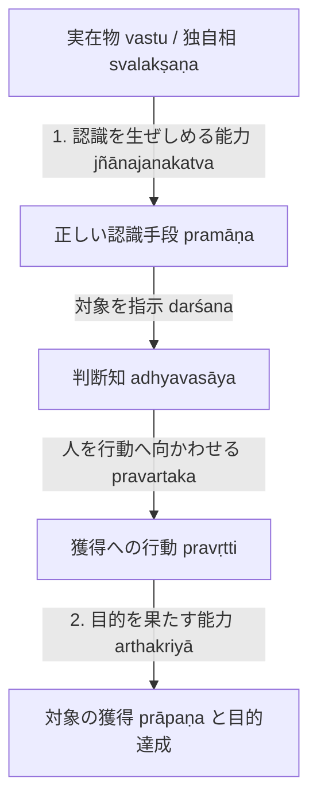

# 目的実現と目的実現能力 (arthakriyāとarthakriyāsāmarthya)

仏教論理学・認識論における実在性（勝義有）と正しい認識手段（[[ja/正しい認識手段 (pramāṇa)|正量]]）の妥当性を基礎づける根幹概念。サンスクリット：*arthakriyā*（目的実現・効果的作用）および *arthakriyāsāmarthya*（目的実現能力）。博士論文『第1章 正しい認識手段』§1.1, §1.2 に基づく概念分析。

## 一、 術語の複合語解釈（NBṬ on NB 1.15）

ダルモーッタラは『正理一滴論注』において、*arthakriyāsāmarthya* を次のように厳密に文法解釈する（§1.1）：

> *"arthyata ity arthaḥ | heya upādeyaś ca | heyo hi hātum iṣyata upādeyaś ca upādātum | arthasya prayojanasya kriyā niṣpattiḥ | tasyāṃ sāmarthyaṃ śaktiḥ |"*
> 
> **artha（目的・対象）**：求められるもの（arthyate）を意味し、それは「放棄されるべきもの（heya）」と「獲得されるべきもの（upādeya）」である。放棄されるべきものは放棄しようと望まれ、獲得されるべきものは獲得しようと望まれる。
> **kriyā（実現）**：目的（artha = prayojana）の実現・成就（kriyā = niṣpatti）。
> **sāmarthya（能力）**：その実現に対する潜在的能力・力（sāmarthya = śakti）。

---

## 二、 「目的実現能力」の二重構造（§1.1）

ダルモーッタラのテキスト分析において、「目的実現能力」には二つの局面が存在する：

1. **認識を生ぜしめる能力（jñānajanakatva）**：
   実在物（[[ja/自相 (svalakṣaṇa)|独自相]]・[[ja/真に存在する実在 (vastu)|vastu]]）が、感官知や推理知に対して自己の形相（ākāra）を似せて認識を生起させる直接の因果能力。実在しない虚構（共通相）はこの能力を持たない。
2. **実践的な目的を果たす能力（広義の実効作用）**：
   認識された対象が、外界において実際の用を果たすこと（例：水が渇きを癒やし、火が熱を与え物を燃やすこと）。

---
## 三、 認識手段が欺かない理由と獲得（§1.2）

ダルマキールティは『量評釈』において以下のように定義した：
> *"pramāṇam avisaṃvādi jñānam arthakriyāsthitiḥ / avisaṃvādanaṃ"*（PV 2.1ab）
> （正しい認識とは欺かない認識である。欺かないこととは、目的実現が確定していることである。）

ダルモーッタラはこの規定を継承しつつ、**「獲得（prāpaṇa）」**の論理として精密化する：

- **認識の指示作用（darśana）と獲得（prāpaṇa）**：
  認識手段は自ら対象を掴み取るのではなく、行動対象を示し（darśayitṛ）、人をその対象へと向かわせ（pravartaka）、結果として対象を獲得させる（prāpaka）。
- **獲得の意味**：
  獲得とは、認識によって示された対象そのものを、行動を通じて現実のものとすることである。したがって、示された対象と異なるものを得た場合（例：真珠の光を真珠と誤認して近づき、貝殻を得た場合）は欺瞞であり、正量とはならない。

---

## 典拠
- 博士論文『第1章 正しい認識手段』§1.1「目的実現能力」、§1.2「認識手段が欺かない理由」
- ダルマキールティ『量評釈』第2章（*Pramāṇavārttika* II.1）
- ダルモーッタラ『正理一滴論注』（*Nyāyabinduṭīkā* on NB 1.15）

## 関連概念
- [[ja/正しい認識手段 (pramāṇa)|正しい認識手段 (pramāṇa)]]
- [[ja/真に存在する実在 (vastu)|真に存在する実在 (vastu)]]
- [[ja/自相 (svalakṣaṇa)|自相 (svalakṣaṇa)]]
- [[ja/把握対象と獲得対象 (grāhya-prāpaṇīya)|把握対象と獲得対象 (grāhya-prāpaṇīya)]]
- [[ja/知覚判断 (adhyavasāya)|知覚判断 (adhyavasāya)]]
