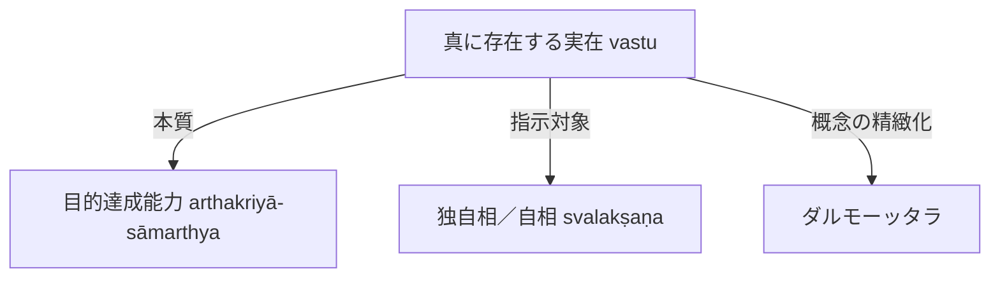

# 真に存在する実在 (vastu)

仏教認識論・論理学派において、目的を実現する能力を持つもの（真に実在するもの）を指す根本術語。

## 一、 根本定義
- 目的を実現する能力（[[ja/目的達成能力 (arthakriyā-sāmarthya)|arthakriyā-sāmarthya]]）を持つものを真に実在するものとし、**vastu**と呼ぶ。
- 勝義有（paramārthasat）であり、[[ja/自相 (svalakṣaṇa)|独自相（自相 svalakṣaṇa）]]と結びつく。

## 二、 ダルモーッタラにおける展開
- ダルモーッタラの思想体系内において、vastuという語は複数の指示対象を持つ。
- 単なる抽象的実在にとどまらず、客観的実在性および認識対象との対応関係において精緻化された。

## 三、 概念連関図

