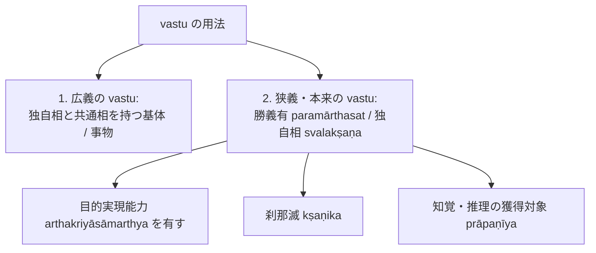

# 真に存在する実在 (vastu)

仏教論理学・認識論において、究極的に実在する事物を指す根本術語。サンスクリット：*vastu*（実在・実在物）。博士論文『第1章 正しい認識手段』§1.3 に基づき、ダルモーッタラ（Dharmottara）における厳密な二層の用法を整理・規定する。

## 一、 ダルモーッタラにおける vastu の二重用法（§1.3）

ダルモーッタラにおける *vastu* という語には、論脈に応じた二つの明確な用法が存在する：

1. **広義の vastu（独自相と共通相の基体）**：
   - 「独自相と共通相を持つ vastu」という表現に見られる用法。
   - 認識や概念構想の対象全般を含みうる、広義の「事物・指示対象」を指す。
2. **狭義・本来の vastu（真に実在する事物＝独自相）**：
   - **勝義有（paramārthasat）**と同義であり、[[ja/自相 (svalakṣaṇa)|独自相（svalakṣaṇa）]]そのものを指す。
   - **[[ja/目的実現と目的実現能力 (arthakriyāとarthakriyāsāmarthya)|目的実現能力（arthakriyāsāmarthya）]]を持つもののみが真の vastu である**。
   - 虚構された[[ja/共相 (sāmānyalakṣaṇa)|共通相]]は非真実・虚偽なるものであり、無があたかも有るかのように現れているにすぎず、真の vastu ではない。

---

## 二、 認識手段との対応関係

- **知覚における vastu**：
  知覚によって示される対象と、認識の生起の原因となる対象は同一の刹那的 vastu（独自相）である。
- **推理における vastu**：
  推理は実在する証因（煙という vastu）から生じ、実在する所証（火という vastu）を示す。証因と所証の間に成立する[[ja/本質的結合関係 (svabhāvapratibandha)|本質的結合関係（svabhāvapratibandha）]]により、所証の実在性が保証される。

---
## 典拠
- 博士論文『第1章 正しい認識手段』§1.3「真に存在する実在（vastu）」
- ダルモーッタラ『正理一滴論注』（*Nyāyabinduṭīkā* on NB 1.12--15）
- ダルマキールティ『量評釈』（*Pramāṇavārttika* II.1ff., III.1--3）

## 関連概念
- [[ja/自相 (svalakṣaṇa)|自相 (svalakṣaṇa)]]
- [[ja/共相 (sāmānyalakṣaṇa)|共相 (sāmānyalakṣaṇa)]]
- [[ja/目的実現と目的実現能力 (arthakriyāとarthakriyāsāmarthya)|目的実現と目的実現能力 (arthakriyāとarthakriyāsāmarthya)]]
- [[ja/正しい認識手段 (pramāṇa)|正しい認識手段 (pramāṇa)]]
- [[ja/把握対象と獲得対象 (grāhya-prāpaṇīya)|把握対象と獲得対象 (grāhya-prāpaṇīya)]]
