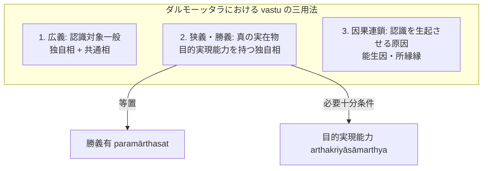

# 真に存在する実在 (vastu)

仏教論理学・認識論において「客観的実在」「真に存在する事物」を指す根本術語。サンスクリット：*vastu*（実在・実在物）。博士論文『序論』§0.6 および『第1章 正しい認識手段』§1.3 に基づく厳密な体系的規定。

## 一、 根本規定：目的実現能力との等置

ダルモーッタラにおいて、真の実在（vastu）とは**目的実現能力（[[ja/目的実現と目的実現能力 (arthakriyāとarthakriyāsāmarthya)|arthakriyāsāmarthya]]）を持つもの**であり、究極の真実（勝義有 paramārthasat）と同義である。

> *"arthakriyāsamarthaṃ yat tad atra paramārthasat |"*（PV 3.3a）
> （ここで目的実現能力を持つもの、それこそが勝義に存在するものである。）

実在物（vastu）は、因果的能力（śakti）によって結果を生じせしめ、時間・空間・本性において他と弁別された**[[ja/自相 (svalakṣaṇa)|独自相（svalakṣaṇa）]]**として一刹那ごとに生滅する。

---

## 二、 ダルモーッタラにおける vastu の重層的用法（§1.3）

ダルモーッタラの著作（『正理一滴論注』NBṬ等）における *vastu* という語の用法は、文脈に応じて以下の三重の広狭を持つ（§1.3）：

1. **広義の vastu（認識対象一般）**：
   独自相と共通相の双方を包摂する用法。認識（知覚・推理）の対象となりうるもの全般を指し、概念構想された対象（共通相）も含みうる。
2. **狭義・勝義の vastu（独自相・真の実在物）**：
   目的実現能力（arthakriyāsāmarthya）を現実に備えた個物。概念構想を離れ、時間的・空間的に限定された勝義有（paramārthasat）のみを指す。
3. **因果連鎖における実在物（原因・結果）**：
   前刹那の原因として後刹那の結果を生み出す相続（santāna）上の実体。認識を生ぜしめる能力（jñānajanakatva）を持ち、認識の因（所縁縁・能生因）となりうるもの。

---

## 三、 知覚・推理の対象論における vastu（§0.6, §1.3）

ダルモーッタラ認識論において、知覚と推理はともに実在物（vastu）を究極の獲得対象とする：

- **知覚における vastu**：
  知覚を生起させる原因となる実在物（把握対象＝独自相）と、知覚判断によって「これである」と決定され獲得される実在物（獲得対象＝刹那の相読上にある実在物）は、同一の因果系列に属する。
- **推理における vastu**：
  推理の把握対象は概念的虚構である[[ja/共相 (sāmānyalakṣaṇa)|共通相]]であるが、推理の生起原因は実在する証因（煙）であり、推理が示す対象も実在する所証（火）である。証因と所証の間に不可離な[[ja/本質的結合関係 (svabhāvapratibandha)|本質的結合関係]]が成立しているため、推理もまた実在物（vastu）を正しく獲得させることができる。

---

## 典拠
- 博士論文『序論』§0.6「導入部」
- 博士論文『第1章 正しい認識手段』§1.3「実在」
- ダルマキールティ『量評釈』第3章（*Pramāṇavārttika* III.3）
- ダルモーッタラ『正理一滴論注』（*Nyāyabinduṭīkā*）

## 関連概念
- [[ja/自相 (svalakṣaṇa)|自相 (svalakṣaṇa)]]
- [[ja/共相 (sāmānyalakṣaṇa)|共相 (sāmānyalakṣaṇa)]]
- [[ja/目的実現と目的実現能力 (arthakriyāとarthakriyāsāmarthya)|目的実現と目的実現能力 (arthakriyāとarthakriyāsāmarthya)]]
- [[ja/把握対象と獲得対象 (grāhya-prāpaṇīya)|把握対象と獲得対象 (grāhya-prāpaṇīya)]]
- [[ja/正しい認識手段 (pramāṇa)|正しい認識手段 (pramāṇa)]]
- [[ja/ダルモーッタラ (Dharmottara)|ダルモーッタラ (Dharmottara)]]
