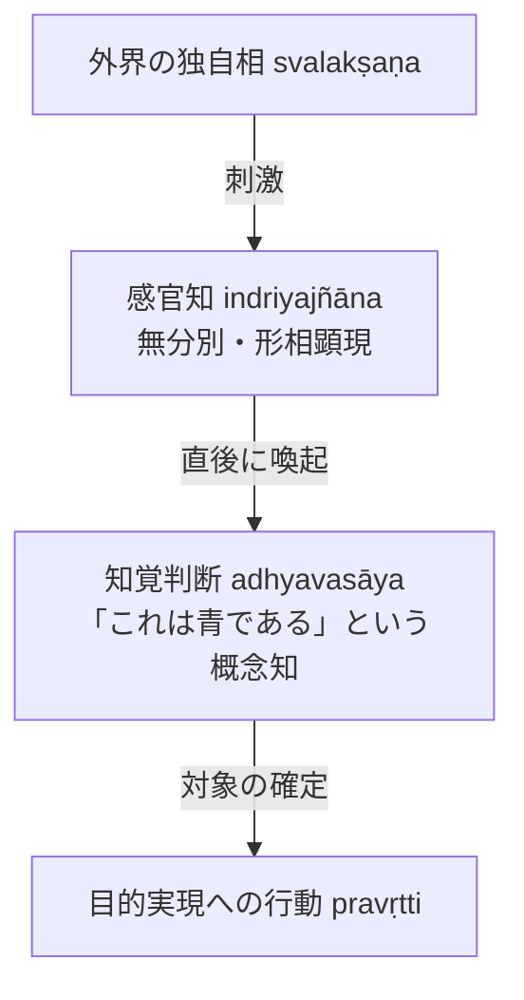

# 知覚判断 (adhyavasāya)

ダルモーッタラ（Dharmottara）認識論における核心概念。無分別である直接知覚（[[ja/現量 (pratyakṣa)|現量]]）と行動世界を架橋する概念的確定知（『序論』§0.6, §0.7）。

## 一、 定義と認識結果（pramāṇa-phala）

- **直接知覚の無分別性**：
  知覚は構想作用（分別）を離れて外界の独自相（[[ja/自相 (svalakṣaṇa)|svalakṣaṇa]]）をありのままに捉えるが、無分別であるため、それ自身としては「これは何であるか」を確定することができない。
- **知覚判断の介在**：
  感官知が生じた直後、その感官知の力によって**知覚判断（adhyavasāya）**と呼ばれる概念知が生じる。知覚判断は、感官知に顕現した形相について「これは目の前にある青についての認識である」と確定する。
- **認識結果としての対象理解**：
  ダルモーッタラにおいて、正しい認識手段（プラマーナ）の結果とはこの「対象理解（判断）」に他ならない（沖 1990, 西沢 2015）。

---

## 二、 推理（比量）における判断知との対応

推理においても同様の構造が成立する：
- 推理知に顕現する火の姿は概念的な共通相（[[ja/共相 (sāmānyalakṣaṇa)|sāmānyalakṣaṇa]]）である。
- 人は目的実現能力のない概念顕現に対しては行動を起こさないため、推理知の後に「この推理知はあの山に実在する火についての認識である」と外界の実在物（[[ja/真に存在する実在 (vastu)|vastu]]）へ付託する判断知が不可欠となる。

---

## 三、 学説史上の意義

- **西沢 2015 の指摘**：
  直接知覚には「認識手段」と「認識手段でないもの」の二つの側面が認められる。直接知覚は無分別であるため自ら対象を確定できないが、**知覚判断と共働することによって初めて対象を確定する**。

---

## 関連概念
- [[ja/現量 (pratyakṣa)|現量 (pratyakṣa)]]
- [[ja/把握対象と獲得対象 (grāhya-prāpaṇīya)|把握対象と獲得対象 (grāhya-prāpaṇīya)]]
- [[ja/ダルモーッタラ (Dharmottara)|ダルモーッタラ (Dharmottara)]]
- [[ja/真に存在する実在 (vastu)|真に存在する実在 (vastu)]]