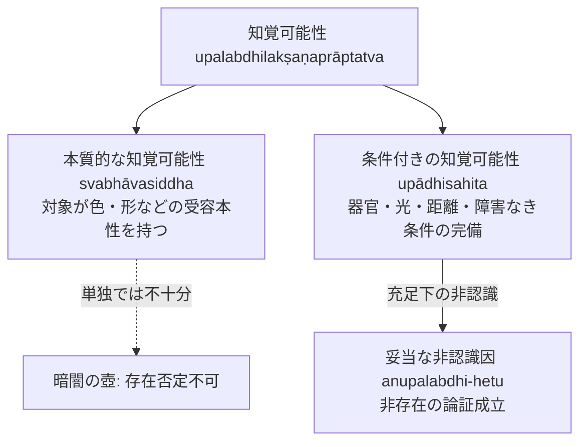

# 知覚可能性の二重性 (upalabdhilakṣaṇaprāptatva)

非認識因（anupalabdhi-hetu）において対象の非存在を論証するための必須条件である「知覚可能性」に対する、ダルモーッタラ独自の二重構造解明。

## 一、 問題の所在

ある場所に対象（例えば壺）が存在しないことを論証するためには、単に「見えない」だけでは足りない（暗闇の壺は見えないが存在しうる）。したがってダルマキールティは、**「知覚可能である条件が揃っているにもかかわらず認識されないこと」**を証因の条件とした。
ダルモーッタラは『正理一滴論注』において、この「知覚可能性（*upalabdhilakṣaṇaprāptatva*）」に次の相異なる二重の水準を見出した。

---
## 二、 二種の知覚可能性の定義（『第2章』§2.2.1）

1. **条件付きの知覚可能性（upādhisahita-）**：
   視覚器官の健全さ、十分な照明（光）、適切な距離・位置・障害物の不在など、知覚を生ぜしめるための認識条件（諸縁）がすべて充足している状態。
2. **本質的な知覚可能性（svabhāvasiddha-）**：
   対象そのものが、本性的に感官によって捉えられうる性格（色・形などの実在性）を備えていること。

### 二者の論理的関係
- 単なる「本質的知覚可能性」のみでは非認識因は成立しない（暗闇の壺の例）。
- したがって、**非存在を論証する証因として直接機能するのは、常に「条件付きの知覚可能性」が満たされている場面における非認識である**。

---

## 三、 屍鬼（piśāca）の非存在論証と相互排除対立（『第2章』§2.2.3）

人間にとって本質的に不可視（知覚不可能）とされる「屍鬼」の非存在をどのように論証するのか：

- **ダルモーッタラの解決**：
  屍鬼のような本質的に知覚不可能な対象については、直接の知覚可能性を適用するのではなく、**相互排除対立（*parasparaparihārasthitilakṣaṇavirodha*）**を用いる。
- すなわち、屍鬼が存在しないことと対立する実在状態（日光に照らされた清浄な地面など）が確認されていることを通じて、間接的に条件付き知覚可能性の枠組みへと還元して非存在を論証する。

---
## 典拠
- 博士論文『第2章 自己の為の推理』§2.2「ダルモーッタラにおける『知覚可能性』の二重性」
- ダルマキールティ『正理一滴論』（*Nyāyabindu* 2.12--14）
- ダルモーッタラ『正理一滴論注』（*Nyāyabinduṭīkā* 2.12--14）

## 関連概念
- [[ja/三種証因 (trividha-hetu)|三種証因 (trividha-hetu)]]
- [[ja/非認識因と付託の構造 (anupalabdhiとsamāropa)|非認識因と付託の構造 (anupalabdhiとsamāropa)]]
- [[ja/比量 (anumāna)|比量 (anumāna)]]
- [[ja/因の三相 (trairūpya)|因の三相 (trairūpya)]]
