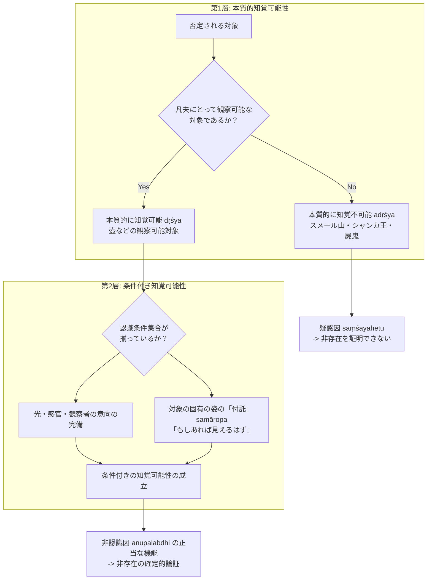

# 知覚可能性の二重性（条件付きと本質的）

非認識因（*anupalabdhi-hetu*）による非存在の論証において、対象が「知覚可能（*dṛśya / upalabdhilakṣaṇaprāpta*）」であることの論理的内実をめぐる根本問題。ダルモーッタラ（Dharmottara）の記述に基づき、博士論文『第二章 自己の為の推理』§2.2, §2.3 が解明した画期的知見。

## 一、 問題の所在：非存在を証明できる証因の条件

ダルマキールティは『正理一滴論』（NB 2.47）において、**知覚可能な対象の非認識（dṛśyānupalabdhi）のみが非存在（abhāva）を決定できる正因であり、知覚不可能な対象の非認識は疑惑因（saṃśayahetu）にとどまる**と規定した。
しかし、「対象が知覚可能である」とは具体的に何を意味するのか。ダルモーッタラのテキストには、相反するように見える二種の用法が存在する。

---

## 二、 二種の知覚可能性の概念規定（§2.2.1）

### 1. 条件付きの知覚可能性（Conditional Perceptibility, §2.2.1.1）
対象が認識されるために必要な**全認識条件集合（sāmagrī）を完備していること**。
- **構成要素**：
  1. **他の認識条件集合の完備（pratyayāntarasākalya）**：十分な光、健全な感官、観察者の注意・意向（manaskāra）。
  2. **対象の特定の固有の姿（svabhāvaviśeṣa）**：その場所に現実に存在するか、または想定されること。
- **「付託（samāropa）」の論理**：
  地面に壺がない場合、壺の固有の姿は客観的には存在しない。全条件が揃わなければ非認識因は機能しないため、観察者は**「もし壺がここに存在するならば、必ず知覚されるはずである」と壺の知覚可能性をその場所に付託（仮定・想定）する**。したがって、非認識因における条件付きの知覚可能性は本質的に**付託された知覚可能性**である。

### 2. 本質的な知覚可能性（Essential Perceptibility, §2.2.1.2）
観察者（凡夫）にとって、**かつて一度は認識されたり、認識されなかったりする二つの経験を持ちうる、観察可能な対象（dṛśya）であること**（NBṬ on NB 2.45: *upalabdhyanupalabdho ca dve yeṣāṃ stas te dṛśyā eva*）。
- **本質的に知覚不可能なもの（adṛśya）との対立**：
  凡夫がいくら努力しても観察不可能な対象、すなわち「場所・時間・自性の点で引き離されているもの（viprakṛṣṭa）」からの排除を意味する：
  - 場所的隔絶：スメール山（凡夫が到達不能な遠隔地）
  - 時間的隔絶：未来のシャンカ王（凡夫の寿命を超えた未来）
  - 自性的隔絶：屍鬼（piśāca, 神通力なき凡夫には不可見の存在）、根本原質（prakṛti）
- **機能**：対象がそもそも凡夫の論証・認識の俎上に載せうる通常の実在対象（壺など）であることを保証する。

---

## 三、 観察者相対性（ekapratipattrapekṣa, §2.2.1.3）

ダルモーッタラは『正理一滴論注』において次のように明言する：
> *"ekapratipattrapekṣam idaṃ pratyakṣalakṣaṇam |"*（NBṬ on NB 2.14）
> （この知覚条件は、一人の観察者を期待するものである。）

知覚可能性は、対象に内在する絶対的・客観的性質ではなく、**特定の「観察者（凡夫）」の視点との相対関係においてのみ成立する**。仏や菩薩のような神通力者にとっては「本質的に知覚不可能なもの」は存在しないため、因明論理学が対象とする観察者は常に凡夫として設定される。

---

## 典拠
- 博士論文『第二章 自己の為の推理』§2.2「ダルモーッタラにおける『知覚可能性』の二重性」、§2.3「非認識因における付託の構造」
- ダルマキールティ『正理一滴論』（*Nyāyabindu* 2.12--14, 2.45, 2.47）
- ダルモーッタラ『正理一滴論注』（*Nyāyabinduṭīkā*）
- Birgit Kellner 1999, "Integrating Non-cognition into the Theory of Direct Knowledge"

## 関連概念
- [[ja/三種証因 (trividha-hetu)|三種証因 (trividha-hetu)]]
- [[ja/比量 (anumāna)|比量 (anumāna)]]
- [[ja/自相 (svalakṣaṇa)|自相 (svalakṣaṇa)]]
- [[ja/因の三相 (trairūpya)|因の三相 (trairūpya)]]
- [[ja/ダルモーッタラ (Dharmottara)|ダルモーッタラ (Dharmottara)]]
