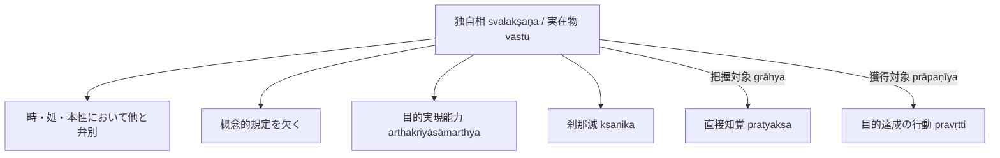

# 自相 (svalakṣaṇa, 独自相)

仏教論理学・認識論における究極の実在概念。サンスクリット：*svalakṣaṇa*（独自相）。

## 一、 本質的規定

本質規定：

> **定義**：**時間的・空間的・本性的に他のあらゆるものから区別された、一切の概念的規定を欠く実在であり、何らかの作用をもたらす「目的実現能力」（arthakriyāsāmarthya）を持つもの。**

- **勝義有（paramārthasat）と実在物（vastu）**：
  ダルモーッタラはこの独自相を**「実在物」（vastu）**または**「勝義有」（paramārthasat）**と呼ぶ（『序論』§0.6, 第1章§1.3）。
- **刹那滅（kṣaṇika）**：
  常住なる実体（実体論的アートマンなど）ではなく、刹那（kṣaṇa）ごとに生起し、直ちに消滅する。

---

## 二、 認識論における位置づけ：把握対象と獲得対象

1. **直接知覚の把握対象（grāhya）**：
   ダルモーッタラによれば、直接知覚（[[ja/現量 (pratyakṣa)|現量]]）の把握対象こそが自相である。直接知覚は分別を交えず、一刹那の自相の形相（ākāra）を直接受容する。
2. **刹那滅と獲得対象（prāpaṇīya）**：
   特定の一刹那における自相は知覚された瞬間に滅するため、獲得されることは不可能である。
   実際に人が獲得するのは、**刹那の連続体（相続 santāna）上にある実在物（独自相）**である（[[ja/把握対象と獲得対象 (grāhya-prāpaṇīya)|把握対象と獲得対象]] を見よ）。
3. **推理における判断付託**：
   推理知の把握対象は共通相であるが、最終的に判断知（adhyavasāya）が実在の独自相へと付託することで、実在する対象の獲得を可能にする。

---

## 典拠
- 『序論』§0.6「導入部」
- ダルマキールティ『量評釈』（*Pramāṇavārttika* III.1--3）
- ダルモーッタラ『正理一滴論注』（*Nyāyabinduṭīkā*）

## 関連概念
- [[ja/共相 (sāmānyalakṣaṇa)|共相 (sāmānyalakṣaṇa)]]
- [[ja/真に存在する実在 (vastu)|真に存在する実在 (vastu)]]
- [[ja/現量 (pratyakṣa)|現量 (pratyakṣa)]]
- [[ja/把握対象と獲得対象 (grāhya-prāpaṇīya)|把握対象と獲得対象 (grāhya-prāpaṇīya)]]
- [[ja/正しい認識手段 (pramāṇa)|正しい認識手段 (pramāṇa)]]
