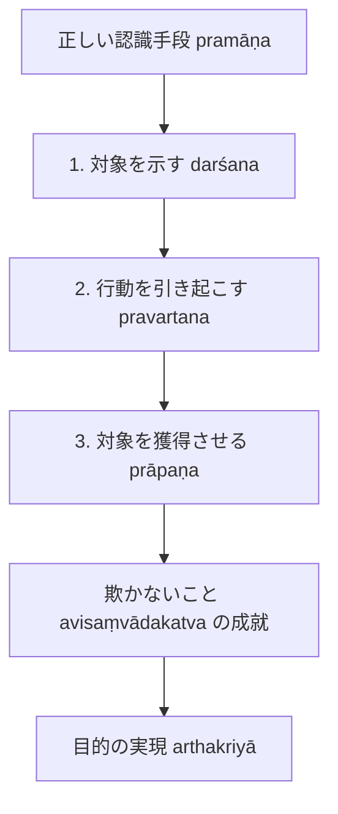

# 認識の欺かなさと獲得 (avisaṃvādakaとprāpaṇa)

正しい認識手段（pramāṇa）の本質規定である「人を欺かないこと」と、その具体的な機能である「対象の指示・行動惹起・獲得」の論理構造。

## 一、 欺かないこと（avisaṃvādakatva）の再解釈

- **ダルマキールティの定義（PV 2.1）**：
  > *"pramāṇam avisaṃvādi jñānam arthakriyāsthitiḥ / avisaṃvādanam"*
  > 正しい認識手段とは欺かない認識である。目的実現の確定が欺かないことである。
- **ダルモーッタラの解釈（『第1章』§1.2）**：
  ダルモーッタラは『正理一滴論注』において、「目的実現の確定」を認識と実在世界との連関において次のように構造化する：
  1. 認識が自ら手を取って対象の場所へ連れて行くのではない。
  2. **対象を示すこと（darśana）**：認識はまず特定の時・処・形相において実在する対象を提示する。
  3. **行動を促すこと（pravartana）**：対象が提示されることによって、人間はその対象を獲得または放棄するための行動を起こす。
  4. **対象を獲得させること（prāpaṇa）**：認識が提示した通りの対象が行動を通じて獲得される。この一連の過程が成立するとき、認識は「人を欺かない（avisaṃvādaka）」と判定される。

---

## 二、 指示対象と獲得対象の因果的連関

知覚（現量）と推理（比量）において、「欺かないこと」が成立する機序は次のように分析される（『第1章』§1.2--1.3）：

- **知覚の場合**：
  認識を生ぜしめる原因となった実在対象（原因対象）と、認識によって示され獲得される対象（指示・獲得対象）は同一の系列（相続 santāna）に属する。
- **推理の場合**：
  推理知を生ぜしめる直接の原因は実在する証因（煙）である。証因は所証（火）と[[ja/本質的結合関係 (svabhāvapratibandha)|本質的結合関係]]（因果関係または同一性）を持つため、証因の実在性によって所証の実在性が必然的に保証され、欺くことがない。

---

## 典拠
- ダルマキールティ『量評釈』（*Pramāṇavārttika* II.1）
- ダルモーッタラ『正理一滴論注』（*Nyāyabinduṭīkā* 1.1--1.4）

## 関連概念
- [[ja/正しい認識手段 (pramāṇa)|正しい認識手段 (pramāṇa)]]
- [[ja/目的実現と目的実現能力 (arthakriyāとarthakriyāsāmarthya)|目的実現と目的実現能力 (arthakriyāとarthakriyāsāmarthya)]]
- [[ja/把握対象と獲得対象 (grāhya-prāpaṇīya)|把握対象と獲得対象 (grāhya-prāpaṇīya)]]
- [[ja/知覚判断 (adhyavasāya)|知覚判断 (adhyavasāya)]]
- [[ja/真に存在する実在 (vastu)|真に存在する実在 (vastu)]]
