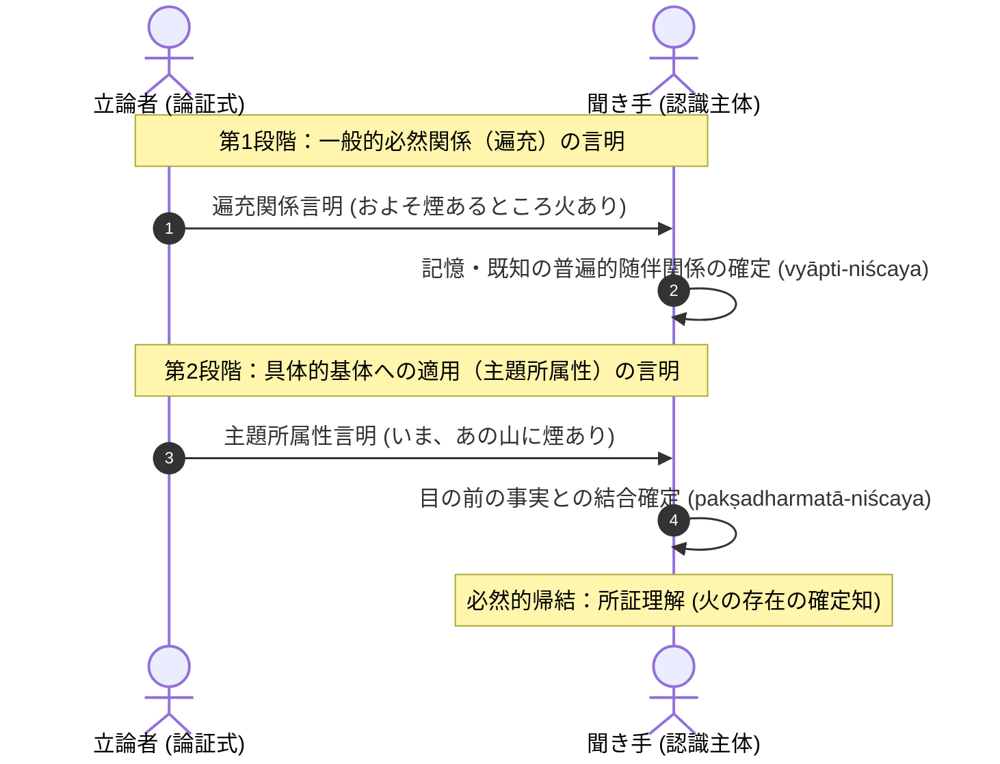

# 論証式における言明順序（遍充関係と主題所属性）

仏教論理学において、他者のための推理（論証式）を構成する二大支分である「遍充関係（vyāpti）」と「主題所属性（pakṣadharmatā）」の言明順序をめぐる厳密な論理学的規定。博士論文『第5章 ダルモーッタラによる論証式理解』§5.2 に基づく。

---

## 一、 問題の所在：伝統的作法との断絶

1. **ディグナーガ（陳那）の作法**：
   - 主張（pakṣa） $\rightarrow$ 因（hetu, 主題所属性） $\rightarrow$ 喩（dṛṣṭānta, 遍充関係）
   - 証因が主題に存在すること（主題所属性）を先に提示し、その後に同品・異品の喩例によって普遍的関係を補足する。
2. **法称（ダルマキールティ）の変革（NB 3.10--11, 3.28--34）**：
   - 法称は同品所属性論証式（sādharmyavat-prayoga）および異品所属性論証式（vaidharmyavat-prayoga）の双方において、**まず遍充関係を言明し、その後に主題所属性を言明する順序を不可動の原則**として定立した。

---

## 二、 ダルモーッタラによる言明順序の必然性の論証（NBT on NB 3.34）

なぜ「主題所属性が先、遍充関係が後」ではいけないのか。ダルモーッタラは『正理一滴論注』において、聞き手の認識生起のメカニズムからその論理的必然性を解明する：

> *"śrotāro hi pramāṇenāpratīte vyāptipakṣadharmatve na sādhyaṃ avagantuṃ śaknuvanti | tasmād anayor vacanaṃ prathamam eva kartavyam |"*
> （聞き手は、遍充関係と主題所属性とが正しい認識手段によって知られていないならば、所証を理解することができない。それゆえ、これら二つの言明こそが最初になされなければならない。）

### 1. 遍充関係の先行性
- **証因の論理的能力の源泉**：
  証因（例：煙）が所証（例：火）を証成できる能力は、証因と所証との間に存する不可離な関係（本質的結合関係 svabhāvapratibandha）＝**遍充関係（vyāpti）**に由来する。
- 遍充関係（「およそ煙のあるところには火がある」）が確定していない段階で、単に「あの山に煙がある（主題所属性）」と聞かされても、煙が火を知らせる理由が不明であるため、聞き手の心には何の確証も生じない。

### 2. 主題所属性の接続による確定
- 一般的法則（遍充関係）がまず聞き手の知覚や推理によって確定された上で、次いで「いま、その証因がこの主題（山）に存在する」という事実（主題所属性）が提示される。
- この二段階の順序を経ることにより、聞き手の心において、大前提と小前提が統合され、所証（「山に火がある」）の理解が必然的に生起する。

---

## 三、 思想史的意義

ダルモーッタラは、言明の順序を単なる修辞学的な作法（レトリック）ではなく、**「他者の心において正しい認識手段（pramāṇa）が作動し、錯誤なく所証理解が導かれるための認識論的・論理的必然法則」**として位置づけた。これにより、仏教論証式は完全な演繹的必然性を備えた論理形式として完成された。

---

## 四、 典拠
- 博士論文『第5章 ダルモーッタラによる論証式理解』§5.2「遍充関係と主題所属性の順序」
- ダルマキールティ『正理一滴論』（*Nyāyabindu* III.10--11, 28--34）
- ダルモーッタラ『正理一滴論注』（*Nyāyabinduṭīkā* III.28--34）

## 五、 関連概念
- [[ja/他者のための推理と論証式 (parārthānumānaとsādhana)|他者のための推理と論証式 (parārthānumānaとsādhana)]]
- [[ja/本質的結合関係 (svabhāvapratibandha)|本質的結合関係 (svabhāvapratibandha)]]
- [[ja/因の三相 (trairūpya)|因の三相 (trairūpya)]]
- [[ja/比量 (anumāna)|比量 (anumāna)]]
- [[ja/帰謬論証と帰謬還元論証 (prasaṅgaとprasaṅgaviparyaya)|帰謬論証と帰謬還元論証 (prasaṅgaとprasaṅgaviparyaya)]]
