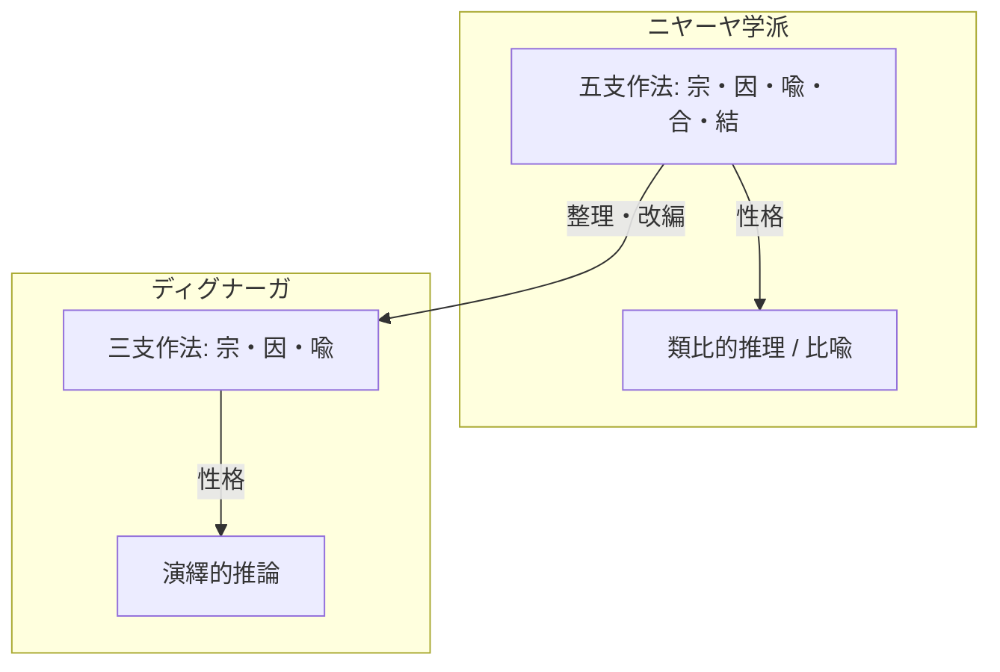

# 論証式の革新（五支作法から三支作法へ）

ディグナーガ（Dignāga）による論理学の体系化における根本的な進展。

## 一、 対比構造

### 1. ニヤーヤ学派の五支作法（類比的推理・比喩）
1. **【宗】（pratijñā 主張）**：音声は無常である。
2. **【因】（hetu 理由）**：生起を属性とするものだから。
3. **【喩】（dṛṣṭānta 喩例）**：生起を属性とする鍋などの実在が無常であることが現に見られる。
4. **【合】（upanaya 適用）**：音声も同様に生起を属性とするものである。
5. **【結】（nigamana 結論）**：したがって、音声は生起を属性とするものだから、無常である。

### 2. ディグナーガの三支作法（演繹的推論）
1. **【宗】（pratijñā 主張）**：音声は無常である。
2. **【因】（hetu 理由）**：努力の直後にあるものであるから。
3. **【喩】（dṛṣṭānta 喩例）**：
   - 〔同喩〕努力の直後にあるものは全て無常であることが経験される（壺などのように）。
   - 〔異喩〕恒常なものは全て努力の直後にあるものではないことが経験される（虚空などのように）。

## 二、 概念連関図

