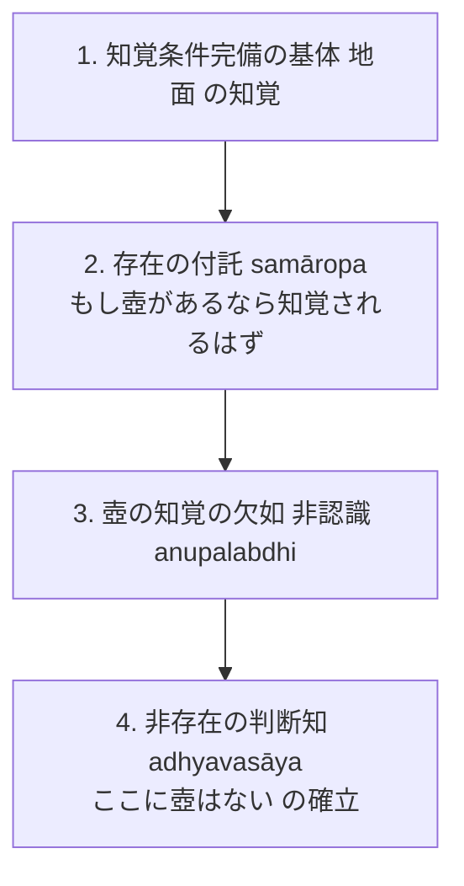

# 非認識因と付託の構造 (anupalabdhiとsamāropa)

実在物ではない「非存在（abhāva）」をいかにして論理的に確定するのか。ダルモーッタラによる「付託（samāropa）」の認識メカニズム。博士論文『第2章 自己の為の推理』§2.3 に基づく厳密な概念分析。

## 一、 付託（samāropa）が要請される理由

- **非存在の非実在性**：
  非存在（無）は実在物（[[ja/真に存在する実在 (vastu)|vastu]]）ではないため、自らの形相を認識に映じ出させる[[ja/目的実現と目的実現能力 (arthakriyāとarthakriyāsāmarthya)|因果的作用能力（目的実現能力）]]を持たない。したがって、非存在そのものを直接知覚することは原理的に不可能である。
- **付託による媒介**：
  非存在を認識するためには、認知者が心の中で「対象が存在する」と反事実的に仮定・投影する操作、すなわち**付託（samāropa）**が必要となる。

---

## 二、 非存在認識の四段階プロセス（『第2章』§2.3.1）

ダルモーッタラによれば、「ここに壺はない」という非存在の判断は次の四段階で成立する：

1. **基体の直接知覚**：認知者は、知覚条件が整った基体（何もない地面）を直接知覚する。
2. **存在の付託（反事実的仮定）**：「もしここに壺があるならば、条件が整っている以上、必ず知覚されるはずである」と、壺の存在を付託する。
3. **知覚の不生起（非認識）**：現実に生起しているのは地面の知覚のみであり、壺の知覚は生じない。
4. **非存在判断の確立**：この非認識を根拠として、付託された壺の存在が否定され、「壺が存在しない」という非存在の判断知（[[ja/知覚判断 (adhyavasāya)|adhyavasāya]]）が確立する。

---

## 三、 三種の否定対象の分析（『第2章』§2.3.2）

| 否定対象 | 性格 | 付託と非存在論証の機序 |
| :--- | :--- | :--- |
| **1. 条件付きで知覚可能な壺** | 日常的な対象 | 認識条件完備（光・視力など）の場での付託と非認識により直接論証。 |
| **2. 屍鬼 (piśāca)** | 本質的に知覚不能な対象 | 単なる非認識では不可。光などの対立実在との**相互排除対立関係**を介して論証。 |
| **3. 部屋の中の冷触感** | 条件付きで知覚不可能な対象 | 外部の観察者には条件不備だが、屋内の因果的結合や遮蔽条件を分析して付託を判定。 |

---
## 典拠
- 博士論文『第2章 自己の為の推理』§2.3「非認識因における付託の構造」
- ダルモーッタラ『正理一滴論注』（*Nyāyabinduṭīkā* 2.12--2.20）

## 関連概念
- [[ja/知覚可能性の二重性 (upalabdhilakṣaṇaprāptatva)|知覚可能性の二重性 (upalabdhilakṣaṇaprāptatva)]]
- [[ja/三種証因 (trividha-hetu)|三種証因 (trividha-hetu)]]
- [[ja/知覚判断 (adhyavasāya)|知覚判断 (adhyavasāya)]]
- [[ja/真に存在する実在 (vastu)|真に存在する実在 (vastu)]]
- [[ja/比量 (anumāna)|比量 (anumāna)]]
