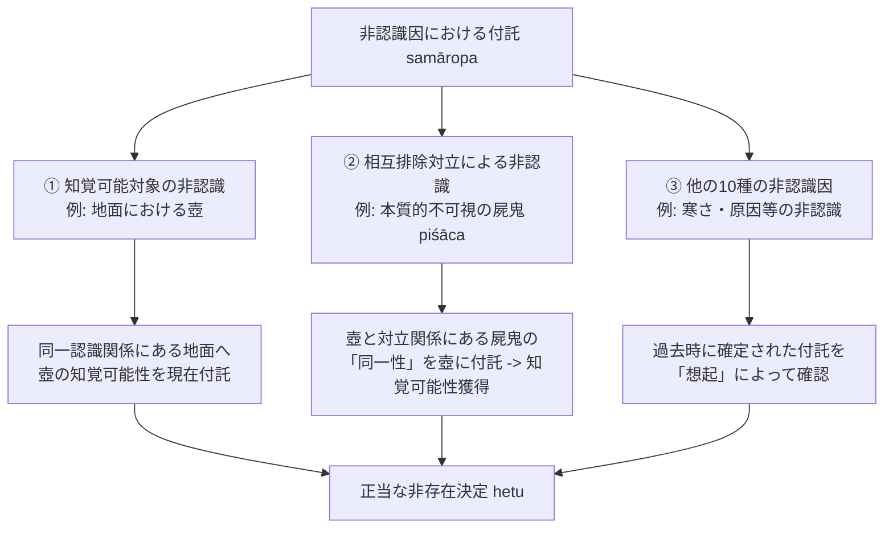

# 非認識因における付託の構造（三種のモデル）

非認識因（*anupalabdhi-hetu*）において、不可視・非存在の対象をいかにして「知覚可能（*dṛśya*）」として論証に乗せるかという課題に対し、ダルモーッタラ（Dharmottara）が構築した「付託（*samāropa* / 想定・仮定）」の精緻な三層モデル。博士論文『第二章 自己の為の推理』§2.3 および『結論』に基づく厳密な概念抽出。

## 一、 付託（samāropa）が必要とされる根本理由

非認識因が正因として機能するためには、対象が**「条件付きの知覚可能性（全認識条件の完備）」**を備えていなければならない（NB 2.13）。
しかし、否定されるべき対象（壺など）がその場所に存在しないとき、全認識条件の一要素である「対象の固有の姿（svabhāvaviśeṣa）」は客観的に欠落している。
この論理的アポリアを解決するため、ダルモーッタラは**「もし対象が存在するならば、全条件が揃っているがゆえに必ず知覚されるはずである」という反事実的仮定を知覚基底に重ね合わせる操作＝「知覚可能性の付託（dṛśyatvasamāropa）」**を導入した。

---

## 二、 非認識因における付託の三種モデル（§2.3.2, 結論）

ダルモーッタラは、否定対象の性質に応じて付託の構造を三種類に厳密に区分する：

### 1. 知覚可能な対象の非認識因（通常の壺など、§2.3.2.1）
- **構造**：同一の認識に関係する二者のうち、一者が見られるとき、他者の知覚可能性が付託される。
- **メカニズム**：現に見られている「地面」に対して、地面と同一認識に属するはずの「壺の条件付き知覚可能性」が付託される。
- **結果**：現に見えている地面の上に、壺が知覚されないことによって、壺の非存在が確実に証明される。

### 2. 相互排除対立関係に基づく屍鬼（piśāca）の非存在証明（§2.3.2.2）
- **課題**：屍鬼は本来、凡夫にとって「本質的に知覚不可能なもの（adṛśya）」であり、ダルマキールティの体系では疑惑因にとどまるはずである。
- **ダルモーッタラの解決策**：
  - 屍鬼は現前にある「壺」と**相互排除対立関係（parasparaparihāra-virodha）**にある。
  - 壺と対立する屍鬼が持つ「壺との同一性」が、現に見られている壺に付託される。
  - これにより、本質的には不可視の屍鬼が、付託を通じて**「条件付きの知覚可能性」を獲得し、正当な「知覚可能対象の非認識因」へと転換**される。

### 3. 他の十種の非認識因における過去時の付託（冷触感の非存在など、§2.3.2.3）
- **構造**：結果の非認識、原因の非認識など、自性非認識以外の10種の非認識因。
- **メカニズム**：
  - 否定を行う「現在」の時点では付託は行われない。
  - 対象（寒さなど）の条件付き知覚可能性の付託は、原因や対立関係を確定した**「過去の時点」**においてすでになされている。
  - ダルモーッタラは、**想起（smaraṇa）**によって過去時の条件付き知覚可能性を確認することで、現在の非存在論証を担保する。

---

## 典拠
- 博士論文『第二章 自己の為の推理』§2.3「非認識因における付託の構造」
- 博士論文『結論』
- ダルマキールティ『正理一滴論』（*Nyāyabindu* 2.12--14, 2.29--47）
- ダルモーッタラ『正理一滴論注』（*Nyāyabinduṭīkā*）

## 関連概念
- [[ja/知覚可能性の二重性（条件付きと本質的）|知覚可能性の二重性（条件付きと本質的）]]
- [[ja/三種証因 (trividha-hetu)|三種証因 (trividha-hetu)]]
- [[ja/本質的結合関係 (svabhāvapratibandha)|本質的結合関係 (svabhāvapratibandha)]]
- [[ja/比量 (anumāna)|比量 (anumāna)]]
- [[ja/ダルモーッタラ (Dharmottara)|ダルモーッタラ (Dharmottara)]]
